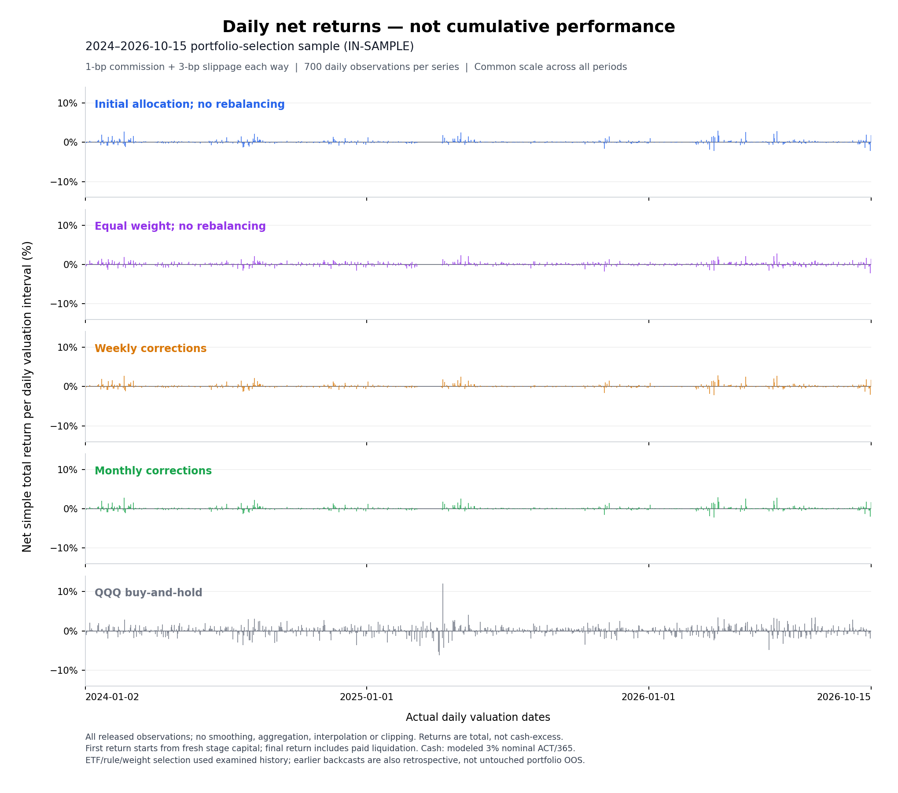

# Trend Following and Mean Reversion ETF Portfolios

The final basket is **GDX, FXI, QQQ, UNG and FDN**.
The historical comparison contains **Initial allocation; no rebalancing**,
**Equal weight; no rebalancing**, **Weekly corrections** and **Monthly corrections**.
The fitted starting allocation is unchanged across frequencies, periods and costs;
the equal-weight comparison starts at **20% per sleeve**. **Nothing was refitted**.

## Current reports

- [Report index and interpretation](reports/etf_portfolios/README.md).
- [All three retrospective periods — all four costs](reports/etf_portfolios/report.md).
- [Full-precision aggregate results, alpha and betas](reports/etf_portfolios/report.json).
- [Fitted-allocation performance CSV](reports/etf_portfolios/performance.csv),
  [full comparison CSV](reports/etf_portfolios/statistical_comparison.csv) and
  [matched QQQ/cash controls](reports/etf_portfolios/controls.csv).
- [Exact starting weights and policies](configs/final_cap_rebalancing.json) and [unchanged strategy definitions](configs/selected_etf_strategies.json).

> **Retrospective research—not untouched portfolio OOS.** Strategies and initial
> weights used the already examined 2024–October 15, 2026 history. Earlier-period
> replay does not remove hindsight. The comparison uses completed, independently
> audited results: no new account simulation, optimizer, price refresh, changed
> retained metrics or live trading.

## Actual cap corrections—not historical cap fits

- **Initial allocation / no rebalancing:** invest once in the five strategy
  accounts; allow their capital shares to drift afterward.
- **Equal weight; no rebalancing:** allocate 20% once to each of the same five
  strategy accounts; let their capital shares drift afterward.
- **Weekly corrections:** check at the last actual trading session of each ISO
  week, at **17:00 New York**. Only a sleeve above one-third queues a correction.
- **Monthly corrections:** the same rule at the last actual trading session of
  each calendar month. October 15 is not treated as an artificial month end.

Queued corrections execute at the **next jointly eligible native 30-minute bar
open**, after corporate actions and normal strategy fills. If the breach has
vanished, cancel the correction. Trim oversized accounts and redistribute the
excess proportionally to the other accounts' **current capital**, recursively
respecting the post-cost cap. Do **not** reset all original target weights.
Long-signal recipients buy ETF shares; flat recipients retain cash. Partial
orders do not change the underlying signal or restart its seven-check wait.

**This is not a continuous cap.** Between-check drift and overnight gaps can
produce shares above one-third; the cap is enforced immediately after an executed
correction, not at every daily close. It limits **strategy-account capital**
(ETF plus cash), not ETF exposure or risk contribution. An execution may be a
cash-only transfer and therefore create no paid ETF order.

## Frozen forward paper portfolio

The user selected **Initial allocation; no rebalancing** as the single primary
forward paper portfolio—not the highest historical frequency result. The five
strategy definitions and exact starting weights are unchanged. Fresh flat paper
accounts start at the sealed future session, with no historical holdings, pending
orders or confirmation streaks carried in.

- [Timestamped public freeze](configs/paper_portfolio_freeze.json).
- [Forward protocol and operating requirements](docs/paper_tracking.md).
- [Paper-tracking status](reports/paper_tracking/README.md).

Historical 2024–2026 results are **not** part of this forward record. Paper
tracking is a simulation, not live execution or a guarantee of future alpha.

## Unchanged initial allocation

| Strategy sleeve | Fitted initial allocation | Equal-weight comparison |
|---|---:|---:|
| GDX | 29.051308% | 20% |
| FXI | 27.991974% | 20% |
| QQQ | 6.304493% | 20% |
| UNG | 26.729328% | 20% |
| FDN | 9.922896% | 20% |

Each period starts independently with **$1,000**, all sleeves initially in cash.
Feature history is carried, not holdings, orders or confirmation streaks. The
exact stored weights—not rounded table values—are used in every calculation.

## Weight sensitivity and statistical evidence

**2024-01-01–2026-10-15 is a retrospective portfolio-selection sample
(in-sample), not untouched portfolio OOS.** ETF selection, rules and starting
weights used this history. Earlier-period portfolio backcasts inherit that
hindsight too; historical ETF-stage names do not make the selected portfolio
independently validated.

Baseline costs; both rows allocate once, with **no rebalancing**:

| Starting allocation | Cash-excess Sharpe | CAGR | Max drawdown | IID mean-excess t | HAC mean-excess t (lag 6) |
|---|---:|---:|---:|---:|---:|
| Fitted weights above | 2.487 | 24.57% | −4.67% | 4.15 | 4.21 |
| Equal initial 20% per sleeve | 2.213 | 23.39% | −5.04% | 3.69 | 3.84 |

The fitted portfolio has **34 completed round trips**, **700 daily return
observations**, and **25.21% mean daily ETF exposure** (about 74.79% cash).
Equal initial weights remove weight fitting, **not** ETF/rule-selection bias.
They are not a daily equal-weight rebalanced portfolio.

The IID t-statistic is `Sharpe × sqrt(n/252)` for mean **cash-excess returns**,
not an alpha t-statistic. Serial correlation makes IID inference unreliable;
see [Lo, *The Statistics of Sharpe Ratios*](https://rpc.cfainstitute.org/research/financial-analysts-journal/2002/the-statistics-of-sharpe-ratios).
The [full statistical comparison](reports/etf_portfolios/statistical_comparison.csv)
adds Newey–West/HAC mean-excess t-statistics for all periods and costs;
the [full-precision JSON](reports/etf_portfolios/statistical_comparison.json)
includes lag sensitivity. **Neither IID nor HAC statistics correct for strategy selection or
multiple testing; no post-selection significance is claimed.**

Cash earns an assumed **3% nominal ACT/365**. It contributes to CAGR; Sharpe
already subtracts the matched cash path, so the cash yield is not itself
excess-return evidence. All mean exposure figures are daily marked averages,
not an intraday exposure guarantee.

## Baseline performance across all three periods

Baseline: **1-bp commission + 3-bp slippage each way**. Each cell is
**cash-excess Sharpe / CAGR / daily maximum drawdown**.

| Portfolio | Development-period backcast 2017–2020 | Validation-period backcast 2021–2023 | Portfolio-selection sample 2024–2026-10-15 (**in-sample**) |
|---|---:|---:|---:|
| Initial allocation; no rebalancing | 1.295 / 16.14% / -8.48% | 0.419 / 7.77% / -19.24% | 2.487 / 24.57% / -4.67% |
| Equal weight; no rebalancing | 1.504 / 19.59% / -7.39% | 0.524 / 8.53% / -15.67% | 2.213 / 23.39% / -5.04% |
| Weekly corrections | 1.295 / 16.14% / -8.48% | 0.470 / 8.32% / -17.54% | 2.514 / 24.60% / -4.67% |
| Monthly corrections | 1.295 / 16.14% / -8.48% | 0.464 / 8.24% / -17.71% | 2.516 / 24.65% / -4.67% |
| QQQ buy-and-hold | 1.063 / 28.39% / -28.56% | 0.387 / 9.84% / -35.12% | 0.996 / 23.93% / -22.77% |

All reports retain **1, 3, 10 and 25 bps slippage each way**, plus 1-bp commission.
Normal strategy, cap and terminal ETF orders pay these costs. Internal cash
transfers and the inherited **fee-free dividend-reinvestment proxy** do not.
Extra cap costs mean direct cap-order fees/slippage, not the difference in total
portfolio returns or total costs versus the benchmark. Taxes and additional
market impact are not modeled.

Cash earns **3% nominal ACT/365 event-compounded**, not 3% APY.
Calendar-day cash accrual and the 252-observation Sharpe annualization serve
different purposes: weekends accrue into the next daily return, and the cash
reference uses exactly the same observation intervals. See the
[cash-clock explanation](docs/etf_methods.md#calendar-time-cash-versus-trading-day-statistics).
Cash-excess Sharpe is above the matched cash path, not above buy-and-hold; cash Sharpe is undefined.
CAGR uses exact first-open-to-terminal elapsed time. Drawdown includes initial
capital and daily valuations, not an intraday maximum.

## Portfolio-selection sample — baseline plots

**January 2024–October 15, 2026; retrospective and in-sample.** Both figures
compare the four portfolios and QQQ buy-and-hold at **1-bp commission + 3-bp
slippage each way**.

### Equity and drawdown


### Daily return plots — baseline costs

The panels show **daily net simple total returns (%)**, not cumulative growth,
drawdown or cash-excess returns. All 700 observations per series are retained
on the same vertical scale without smoothing, clipping or resampling. Returns
include modeled cash interest; the first starts from initial stage capital.



The full period reports pair each performance table with its equity/drawdown
and daily-return plots:

- [Development-period report: 2017–2020](reports/etf_portfolios/development_report.md).
- [Validation-period report: 2021–2023](reports/etf_portfolios/validation_report.md).
- [Portfolio-selection report: 2024–October 15, 2026 (in-sample)](reports/etf_portfolios/historical_OOS_report.md).

[Download verified daily returns and reproduce the plots](reports/reproducibility/README.md).

## Verify and reproduce

```bash
python -m pip install -e '.[test,plots,paper]'
python -m pytest -q
python scripts/verify_etf_publication.py --report-dir reports/etf_portfolios \
  --config configs/final_cap_rebalancing.json
python scripts/verify_daily_returns.py
python scripts/verify_publication.py
```

The portable checks verify published aggregate integrity, exact retained values,
controls, configuration, tables and raster metadata; they are **not** new
financial backtests. The detached subset receipt records the original source
aggregate's hash and the frozen retained-value digest. Comparing directly with
the unpublished original aggregate requires that private source.

The costed canonical-event kernels are included with synthetic tests. Exact
financial reproduction needs the privately retained authenticated inputs,
causal signal/event primitives and saved accounts; they are not redistributed.
See [current methods](docs/etf_methods.md) and [data access](docs/etf_data_sources.md).

## Publication scope and provenance

The current tree presents the **47-ETF research scope** listed below and the
five-strategy portfolio above, consistently from methodology through results.
Earlier snapshots are retained privately and unchanged rather than mixed into
this publication. Git history is not rewritten.

This is a retrospective, scope-restricted presentation of previously examined
research—not a newly executed 47-ETF screening campaign. Scope cleanup changes
neither a retained strategy definition nor a portfolio weight, account path,
metric or control. No new stage membership counts are invented.

## Data sources and full research dataset


**Market-data provider: [Alpha Vantage](https://www.alphavantage.co/documentation/).**
The historical study uses daily OHLCV, adjusted closes, dividends and split
coefficients from `TIME_SERIES_DAILY_ADJUSTED`, plus **30-minute OHLCV**
from `TIME_SERIES_INTRADAY`, using verified native raw or matching-vintage-restored
legacy observations. Available **15-minute** captures provide additional
reconciliation evidence; they are not a complete 15-minute dataset for every ETF.
Separate captures and daily anchors are cross-checks from the **same provider**,
not independent-vendor confirmation. Trading sessions use the XNYS calendar in
[exchange_calendars](https://github.com/gerrymanoim/exchange_calendars).
Cash returns are modeled at 3% nominal ACT/365, not downloaded Treasury yields.

### Published 47-ETF universe

- **US equity indices (6):** SPY, QQQ, DIA, IWM, MDY, VTI.
- **International / country equities (13):** EEM, EFA, EWA, EWC, EWJ, EWT, EWW, EWY, EWZ, FXI, INDA, MCHI, VGK.
- **Broad US sectors (10):** XLB, XLE, XLF, XLI, XLK, XLP, XLRE, XLU, XLV, XLY.
- **Industries / subsectors (13):** FDN, GDX, GDXJ, IBB, ITB, KBE, KRE, SMH, SOXX, XBI, XHB, XOP, XRT.
- **Commodities / precious metals (5):** DBC, GLD, SLV, UNG, USO.

The research window is **2017-01-01–2026-10-15**, with daily feature initialization
from **2015**, subject to actual ETF inception and available history. The restored active
split is **2017–2020 development**, **2021–2023 validation**, and
**2024-01-01–2026-10-15 portfolio-selection sample (in-sample)**.
The internal historical_OOS identifier is retained only for compatibility. Stage eligibility is separate from the universe:
listing an ETF does not mean it advances to every stage. These are listed ETF
returns, not index levels, spot commodities or synthetic leveraged products.

**Data availability:** raw ETF captures, sleeve accounts, fills and private audit
inputs remain private. [Derived aggregate daily returns](reports/reproducibility/README.md)
are now public, including matched QQQ buy-and-hold and cash returns. A portable
verification script recomputes the published summary statistics without raw ETF data.
This is metric reproducibility, not end-to-end recreation of signals and trades. See the
[dataset specification and access/reproduction notes](docs/etf_data_sources.md)
for fields, price adjustments, coverage limits and the private input requirement.
The historical comparison contains **four portfolios** across the same five ETF
strategy sleeves: fitted initial allocation, equal weight, Weekly corrections
and Monthly corrections, plus matched QQQ buy-and-hold and cash controls.
The 47-ETF research scope is context, not a pooled 47-ETF portfolio.
