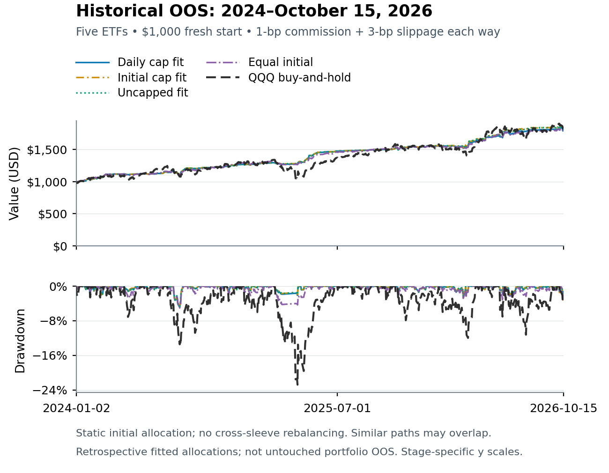

# Trend Following and Mean Reversion ETF Portfolios

The **final basket contains no bond ETFs**: **GDX, FXI, QQQ, UNG and FDN**.
The four retained portfolios are **Daily cap fit, Initial cap fit, Uncapped fit
and Equal initial**. The removed cap variants and standalone Maximum CAGR
portfolio are excluded from all active reports, charts and comparisons.

## Current reports

- [Report index](reports/final_no_bond_portfolios/README.md) and [all-period tables](reports/final_no_bond_portfolios/combined_report.md).
- [Development — 2017–2020](reports/final_no_bond_portfolios/development.html).
- [Validation — 2021–2023](reports/final_no_bond_portfolios/validation.html).
- [Historical OOS — 2024–October 15, 2026](reports/final_no_bond_portfolios/historical_OOS.html).

Each offline HTML includes **all four execution costs**, fresh-$1,000 accounts,
matched QQQ/cash controls, equity and drawdown, QQQ-only and **joint-five-ETF**
alpha/beta, daily capital-share diagnostics and strategy/portfolio correlations.
See [full-precision aggregate JSON](reports/final_no_bond_portfolios/report.json),
[exact saved weights](configs/final_no_bond_portfolios.json),
[strategy definitions](configs/no_bond_selected_strategies.json) and
[independent subset audit](reports/final_no_bond_portfolios/independent_audit.json).

> **Retrospective research—not untouched portfolio OOS.** The retained weights
> were fitted on the already examined **2024–October 15, 2026** history. Replaying
> them in earlier periods does not remove hindsight. The removal is a literal
> saved-result subset: **no refitting, account reruns or changed metrics**.
> Numerical source fits are best-found, not globally certified; no live allocation
> or trading is authorized.

## Four portfolio definitions

- **Daily cap fit:** each initial allocation and every fitted historical OOS daily
  sleeve-capital share is at most one-third, across all four costs.
- **Initial cap fit:** each starting allocation is at most one-third; **no later
  enforcement**. Shares may subsequently drift above that value.
- **Uncapped fit:** nonnegative initial weights summing to one, without the cap.
- **Equal initial:** one-time **20%** allocation to each of the five strategies.

**None rebalances.** Portfolio wealth is the sum of initial allocations multiplied
by each saved strategy-account wealth path, including idle cash. This is not
constant-weight return mixing. Cap checks do not create transfers or trades.
Earlier-period concentration breaches remain visible; no historical cap is a
future or intraday guarantee. BND is excluded from both allocations and joint
passive-factor regressions, but the original modeled cash interest is unchanged.

## Initial allocations

| Strategy sleeve | Daily cap fit | Initial cap fit | Uncapped fit | Equal initial |
|---|---:|---:|---:|---:|
| GDX | 24.5454% | 29.0513% | 29.0513% | 20.0000% |
| FXI | 30.1404% | 27.9920% | 27.9920% | 20.0000% |
| QQQ | 7.0341% | 6.3045% | 6.3045% | 20.0000% |
| UNG | 27.7007% | 26.7293% | 26.7293% | 20.0000% |
| FDN | 10.5794% | 9.9229% | 9.9229% | 20.0000% |

Initial cap and Uncapped selected the same allocation; their curves overlap.
The exact stored weights—not the rounded table—are used for every period and cost.

## Baseline performance across all three periods

Baseline: **1-bp commission + 3-bp slippage each way**. Each cell is
**cash-excess Sharpe / CAGR / daily maximum drawdown**.

| Portfolio | Development 2017–2020 | Validation 2021–2023 | Historical OOS 2024–2026-10-15 |
|---|---:|---:|---:|
| Daily cap fit | 1.350 / 16.28% / -8.06% | 0.417 / 7.83% / -19.57% | 2.476 / 23.85% / -4.91% |
| Initial cap fit | 1.295 / 16.14% / -8.48% | 0.419 / 7.77% / -19.24% | 2.487 / 24.57% / -4.67% |
| Uncapped fit | 1.295 / 16.14% / -8.48% | 0.419 / 7.77% / -19.24% | 2.487 / 24.57% / -4.67% |
| Equal initial | 1.504 / 19.59% / -7.39% | 0.524 / 8.53% / -15.67% | 2.213 / 23.39% / -5.04% |
| QQQ buy-and-hold | 1.063 / 28.39% / -28.56% | 0.387 / 9.84% / -35.12% | 0.996 / 23.93% / -22.77% |

The reports include **1, 3, 10 and 25 bps slippage each way**, plus 1-bp commission.
Cash is **3% nominal ACT/365 event-compounded**, not 3% APY. Cash-excess Sharpe is
above the matched cash path, not above buy-and-hold; cash Sharpe is undefined.
CAGR uses exact first-open-to-terminal elapsed time. Drawdown includes initial
capital and daily valuations, not an intraday maximum.



## Verify and reproduce

```bash
python -m pip install -e '.[test,plots]'
python -m pytest -q
python scripts/verify_project.py
python scripts/verify_no_bond_portfolios.py --public-report reports/no_bond_portfolios/report.json
python scripts/verify_final_no_bond.py --report reports/final_no_bond_portfolios/report.json \
  --source-report reports/no_bond_portfolios/report.json
```

The first verifier checks publication hashes and historical source archives; the
second checks the complete archived no-bond comparison; the final verifier checks
that every active weight, metric and correlation submatrix is an exact saved
subset. No API key, market download or optimizer is needed. Regenerate current
presentation from public aggregates without changing financial calculations:

```bash
python scripts/build_final_no_bond_reports.py --report reports/final_no_bond_portfolios/report.json \
  --source-report reports/no_bond_portfolios/report.json \
  --figures-dir reports/final_no_bond_portfolios --output-dir outputs/final_no_bond_reports
```

See [current methods](docs/final_no_bond_portfolios.md) and
[data access](docs/data_sources.md). Exact path/fit reproduction needs privately
supplied authenticated saved accounts; no underlying daily arrays are published.

## Preserved historical results

- [Prior six-allocation no-bond comparison](docs/archived_six_portfolio_comparison.md): removed variants are historical only, not active models.
- [Original four-portfolio class project](docs/archived_four_portfolio_snapshot.md) and [PDF/HTML/Word reports](final_reports/README.md): older six-sleeve results, not the current five-ETF final set.
- [Original five-portfolio snapshot](docs/archived_five_portfolio_snapshot.md): includes the excluded Maximum CAGR comparison for provenance only.

All historical financial definitions, account outcomes and freezes remain
unchanged. The separate corrected-split experiment remains inactive/private.

## Data sources and full research dataset


**Market-data provider: [Alpha Vantage](https://www.alphavantage.co/documentation/).**
The historical study uses daily OHLCV, adjusted closes, dividends and split
coefficients from `TIME_SERIES_DAILY_ADJUSTED`, plus **30-minute OHLCV**
from `TIME_SERIES_INTRADAY`, using verified native raw or matching-vintage-restored
legacy observations. Available **15-minute** captures provide additional
reconciliation evidence; they are not a complete 15-minute dataset for every ETF.
Separate captures and daily anchors are cross-checks from the **same provider**,
not independent-vendor confirmation. Trading sessions use the XNYS calendar in
[exchange_calendars](https://github.com/gerrymanoim/exchange_calendars).
Cash returns are modeled at 3% nominal ACT/365, not downloaded Treasury yields.

### Full 56-ETF universe

- **US equity indices (6):** SPY, QQQ, DIA, IWM, MDY, VTI.
- **International / country equities (13):** EEM, EFA, EWA, EWC, EWJ, EWT, EWW, EWY, EWZ, FXI, INDA, MCHI, VGK.
- **Broad US sectors (10):** XLB, XLE, XLF, XLI, XLK, XLP, XLRE, XLU, XLV, XLY.
- **Industries / subsectors (13):** FDN, GDX, GDXJ, IBB, ITB, KBE, KRE, SMH, SOXX, XBI, XHB, XOP, XRT.
- **Bonds (9):** BND, HYG, IEF, IEI, LQD, MBB, SHY, TIP, TLT.
- **Commodities / precious metals (5):** DBC, GLD, SLV, UNG, USO.

The research window is **2017-01-01–2026-10-15**, with daily feature initialization
from **2015**, subject to actual ETF inception and available history. The restored active
split is **2017–2020 development**, **2021–2023 validation**, and
**2024-01-01–2026-10-15 historical OOS**. Stage eligibility is separate from the universe:
listing an ETF does not mean it advances to every stage. These are listed ETF
returns, not index levels, spot commodities or synthetic leveraged products.

**Data availability:** the underlying market captures and full saved daily account paths
are retained privately and are **not downloadable from this repository**. GitHub
contains code, definitions, aggregate results and raster charts. See the
[complete dataset specification and access/reproduction notes](docs/data_sources.md)
for fields, price adjustments, coverage limits and the private input requirement.
The original reports cover four allocations across six selected strategy sleeves; the active final comparison excludes BND and covers four allocations across **five ETF strategy sleeves**.
The original 56-ETF screening universe is context, not a pooled 56-ETF portfolio.
