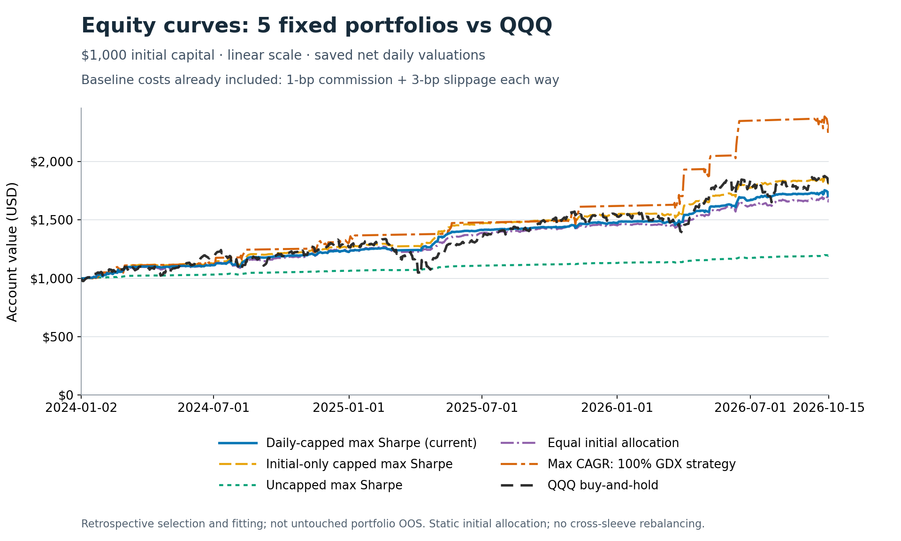
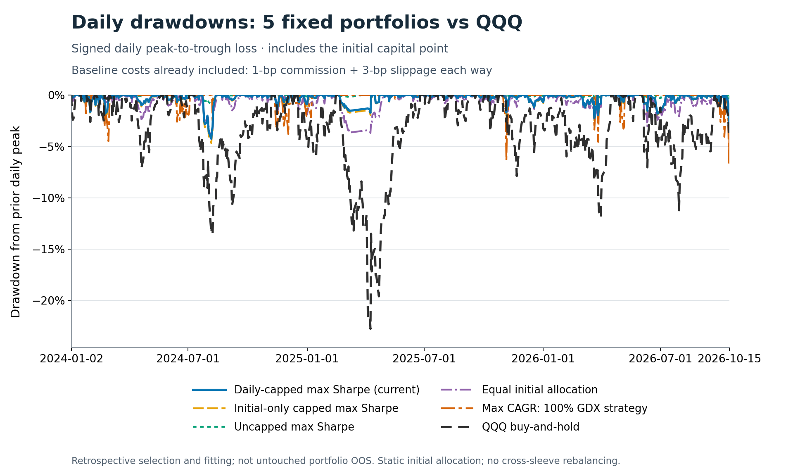

# Archived five portfolio snapshot

This is the earlier five-comparison publication. The [current report index](../final_reports/README.md) contains the four retained portfolios; the standalone maximum-CAGR GDX case is not active. Original numbers and raster assets below are preserved.

# Trend Following Study — ETF trend and mean-reversion portfolios

Calculation code and aggregate results for **six fixed long/cash ETF strategies**:
GDX, FXI, QQQ, UNG, FDN and BND. The portfolio layer compares static initial
allocations, correlations, cost sensitivity, and passive-ETF alpha/beta attribution.

> **Retrospective research, not an untouched portfolio test.** ETF/configuration
> selection, correlation pruning and weight fitting used the already examined
> historical OOS sample. These results are not forward performance estimates,
> investment advice or an executable trading system.

## Current portfolio

The chosen allocation maximizes baseline net **cash-excess Sharpe**, subject to
no sleeve exceeding **one-third of portfolio capital at any of the 700 historical
daily valuations, in any of the four cost scenarios**. Initial capital is allocated
once. Sleeve weights then drift; there are **no cross-sleeve rebalance trades**.
The Sharpe optimization is numerically best-found, not globally certified.

| Strategy sleeve | Initial weight |
|---|---:|
| GDX | 23.5729% |
| FXI | 24.9703% |
| QQQ | 5.6270% |
| UNG | 23.8965% |
| FDN | 8.6317% |
| BND | 13.3015% |

Full-precision weights and unchanged strategy identities are in [configs](../configs/).
Weights allocate **strategy-account capital**, including its idle cash, not
continuous ETF holdings. The historical cap does not enforce future or intraday
limits and is not a risk-contribution cap.

### Historical performance

Scored window: **2024-01-01–2026-10-15**, with 700 common daily observations
from January 2, 2024. Every scenario includes **1-bp commission each way** plus
the listed one-way slippage. The same baseline-fitted weights are used at every cost.

| Slippage each way | Cash-excess Sharpe | CAGR | Daily max drawdown |
|---|---:|---:|---:|
| 1 bp | 2.4924 | 21.98% | −4.23% |
| **3 bps — baseline** | **2.4809** | **21.85%** | **−4.24%** |
| 10 bps | 2.4402 | 21.42% | −4.25% |
| 25 bps | 2.3510 | 20.50% | −4.29% |

“Cash-excess” means returns above the study's matched cash-return path—not above
buy-and-hold. Cash accrues at **3% nominal ACT/365, event-compounded**, not 3% APY.
Drawdown here is measured at daily valuations, not the worst intraday loss.

### Allocation comparisons at baseline

| Portfolio | Cash-excess Sharpe | CAGR | Daily max drawdown |
|---|---:|---:|---:|
| Daily-capped max-Sharpe — current | 2.4809 | 21.85% | −4.24% |
| Initial-only capped max-Sharpe | 2.4872 | 24.57% | −4.67% |
| Uncapped max-Sharpe | 2.4966 | 6.86% | −0.82% |
| Equal initial weights | 2.2043 | 20.46% | −4.27% |
| Maximum CAGR: 100% GDX **strategy** | 1.8186 | 35.33% | −6.59% |

The initial-only cap later reaches about 38.6% in one sleeve and does **not** meet
the chosen daily cap. The uncapped solution allocates about 85.35% initially to
the mostly-cash BND strategy, illustrating that maximum Sharpe need not maximize
growth. Maximum CAGR is a different, uncapped objective—not a one-third-capped
recommendation and not passive GDX buy-and-hold.

### Baseline equity curves and drawdowns

The five saved portfolios and **passive QQQ buy-and-hold** each start with
**$1,000**. All curves use the same **1-bp commission + 3-bp slippage each way**,
the same 700 daily valuations through **October 15, 2026**, and paid terminal
liquidation. Portfolio allocations are the unchanged static initial weights;
there is no reoptimization or daily rebalancing. QQQ here is the cost-matched
passive benchmark, **not** the active QQQ strategy sleeve.





Drawdowns use each curve's own running peak, including its initial balance;
they are **daily**, not intraday losses. These are hindsight-conditioned
historical comparisons, not a new untouched portfolio test. Only raster charts
and aggregate chart metadata are published; the numerical daily paths remain
private. See [chart provenance and reproduction](../docs/charts.md).

### Baseline attribution for the current portfolio

Regress portfolio cash-excess returns jointly on **cost-matched passive
buy-and-hold cash-excess returns**, not the six active strategy returns:

| GDX beta | FXI beta | QQQ beta | UNG beta | FDN beta | BND beta | Annualized arithmetic alpha | R² |
|---:|---:|---:|---:|---:|---:|---:|---:|
| 0.0366 | 0.0369 | 0.0746 | 0.0090 | 0.0516 | −0.0169 | 12.59%/year | 31.37% |

These are conditional linear sensitivities, **not allocation weights**. Negative
BND beta does not imply a short position. Alpha is 252 times the daily intercept,
not CAGR or proof of skill. Separate one-ETF regressions answer a different
question. Full all-cost results and factor-overlap diagnostics are in [results](../results/).

## What is included

- Portable Python analytics and synthetic tests: static wealth mixing, return
  statistics, cap diagnostics, correlations, OLS attribution and optional
  research-only optimization.
- Exact six strategy definitions, five portfolio allocations, and study conventions.
- Sanitized aggregate results for all four costs, including own-ETF buy-and-hold
  comparisons, correlations and regression tables.
- Baseline equity and daily-drawdown PNGs for the five portfolios and passive QQQ.
- [Methodology](../docs/methodology.md), [input schema](../docs/input_schema.md), and
  [reproducibility limits](../docs/reproducibility.md), plus the
  [local verification record](../docs/verification.md).

**Not included:** raw market data, full daily account paths, the original
30-minute execution engine, private reconciliation evidence or study freezes.
This repository cannot reconstruct historical trades from aggregate tables alone.
Historical-number recomputation requires the private saved account input bundle;
tests run on generated synthetic data and public aggregates without it.

## Run

Python 3.10 or later:

```bash
python -m pip install -e '.[test,plots]'
python -m pytest
```

With a separately supplied private bundle matching the [schema](../docs/input_schema.md):

```bash
python scripts/analyze_portfolios.py \
  --input private/portfolio_inputs.npz \
  --portfolios configs/portfolios.json \
  --years 2.787043378995434 \
  --output outputs/recomputed_aggregates.json
```

The default evaluates the saved weights, without optimization or market downloads.
Do not commit the input bundle or generated daily paths. Optional optimizer output
is a new numerical experiment and must not silently replace the published snapshot.

## Historical strategy context

The parent study used development **2017–2020**, validation **2021–2023** and
historical OOS **2024–2026-10-15**. Its 379 definitions per ETF comprised 289
trend and 90 mean-reversion configurations. Daily causal indicators feed native
half-hour observations, with shared three-trading-hour/seven-consecutive-check
confirmation and next eligible bar-open execution. Each stage started independently
with $1,000 and feature history, not inherited holdings or orders.

The six configurations and five portfolio comparisons here were chosen after
examining OOS outcomes. This separate portfolio snapshot does not alter the
original stage memberships, freezes or public study command. The original research
repository is [Agul-quant/trend-following](https://github.com/Agul-quant/trend-following).
