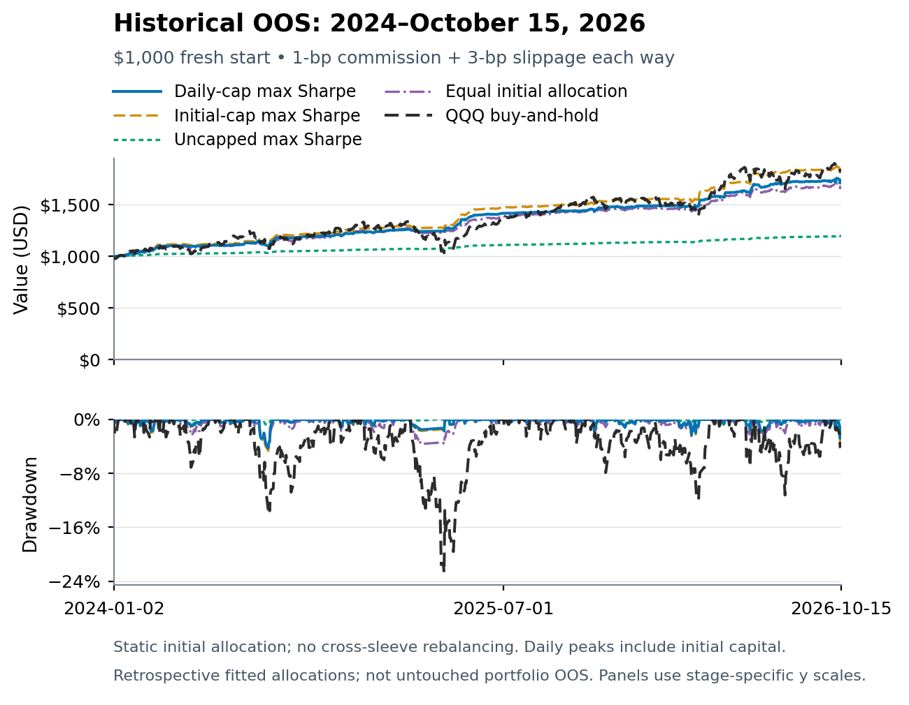

> **Historical four-portfolio snapshot.** The wording and numbers below record the earlier publication, not the active no-bond five-ETF comparison. See the [current project](../README.md).

# Trend Following and Mean Reversion ETF Portfolios

A quantitative finance class project on six fixed long/cash ETF strategies and
four static initial-capital portfolios. The **earlier study is restored as the
active basis**: development **2017–2020**, validation **2021–2023**, and historical
OOS **2024-01-01–2026-10-15**. The separate corrected-split experiment is inactive;
its private artifacts are preserved, not deleted or merged into these results.

## Read the results

1. **Development and robustness — 2017–2020:** [PDF](../final_reports/01_development/01_development_and_robustness.pdf) · [offline HTML](../final_reports/01_development/01_development_and_robustness.html).
2. **Validation and frozen selection — 2021–2023:** [PDF](../final_reports/02_validation/02_validation_and_frozen_selection.pdf) · [offline HTML](../final_reports/02_validation/02_validation_and_frozen_selection.html).
3. **Historical OOS and conclusions — 2024–October 15, 2026:** [PDF](../final_reports/03_historical_oos/03_historical_oos_and_conclusions.pdf) · [offline HTML](../final_reports/03_historical_oos/03_historical_oos_and_conclusions.html).

Reports follow the presentation and course-project structure of the
[cryptocurrency class project](https://github.com/Agul-quant/Cryptocurrency-statistical-arbitrage/),
but retain the ETF study's own signals, clocks, costs, cash and accounting.
Each includes all four portfolios at all four slippages, matched QQQ and cash
controls, equity/drawdown, capital-share diagnostics and QQQ-only/joint-six-ETF
alpha and beta. Failures and undefined cash Sharpe remain visible.

The [report index](../final_reports/README.md) also links the
[complete Word class project](../final_reports/class_project/Trend_Following_Study_Class_Project.docx)
and [reproducibility supplement](../final_reports/class_project/Trend_Following_Study_Reproducibility.zip).
Download an HTML file and open it locally: it works offline and embeds only raster
curves, not numerical daily paths. See [report methods and course coverage](../docs/class_project_reports.md).

> **Retrospective research, not an untouched portfolio test.** Configuration
> selection, ETF pruning and portfolio fitting used already examined historical
> OOS. Replaying the final choices in earlier periods does not remove that
> hindsight. No portfolio is approved for deployment and no new winner is
> selected here. The historical daily-cap fit breaches one-third in validation:
> **UNG reaches 35.18%, with 41 breach days at every cost**.

## Four retained portfolios

The six sleeves are **GDX, FXI, QQQ, UNG, FDN and BND**. The same exact configuration
and initial weights are used in every period and cost. The standalone maximum-CAGR
100%-GDX strategy allocation is excluded from current reports; GDX remains an
underlying sleeve. The original five-portfolio exports and charts stay unchanged
in the [archived snapshot](../docs/archived_five_portfolio_snapshot.md).

| Strategy sleeve | Daily cap fit | Initial cap fit | Uncapped fit | Equal initial |
|---|---:|---:|---:|---:|
| GDX | 23.5729% | 29.0513% | 3.4761% | 16.6667% |
| FXI | 24.9703% | 27.9920% | 4.2909% | 16.6667% |
| QQQ | 5.6270% | 6.3045% | 1.0866% | 16.6667% |
| UNG | 23.8965% | 26.7293% | 4.6524% | 16.6667% |
| FDN | 8.6317% | 9.9229% | 1.1470% | 16.6667% |
| BND | 13.3015% | 0.0000% | 85.3469% | 16.6667% |

Weights allocate strategy-account wealth, including idle cash, not continuous ETF
holdings. Capital is assigned once, then sleeve shares drift; there are no free
cross-sleeve rebalance trades. The daily-cap constraint was fitted to historical
OOS daily capital shares at all four costs, not future or intraday weights. Sharpe
optimization was numerically best-found, not globally certified.

## Baseline performance

Baseline costs are **1-bp commission plus 3-bp one-way slippage, each way**.
Each cell below is **cash-excess Sharpe / CAGR / daily maximum drawdown**.

| Portfolio | Development 2017–2020 | Validation 2021–2023 | Historical OOS 2024–2026-10-15 |
|---|---:|---:|---:|
| Daily cap fit | 1.321 / 14.77% / -7.52% | 0.381 / 6.90% / -17.52% | 2.481 / 21.85% / -4.24% |
| Initial cap fit | 1.295 / 16.14% / -8.48% | 0.419 / 7.77% / -19.24% | 2.487 / 24.57% / -4.67% |
| Uncapped fit | 1.320 / 6.21% / -2.32% | -0.243 / 1.82% / -9.70% | 2.497 / 6.86% / -0.82% |
| Equal initial | 1.506 / 17.43% / -6.56% | 0.473 / 7.30% / -13.48% | 2.204 / 20.46% / -4.27% |
| QQQ buy-and-hold | 1.063 / 28.39% / -28.56% | 0.387 / 9.84% / -35.12% | 0.996 / 23.93% / -22.77% |

All three accounts start independently with **$1,000**; no holdings, orders,
confirmation streaks or wealth carry between stages. Cash is **3% nominal
ACT/365 event-compounded**, not 3% APY. “Cash-excess” is excess over that matched
cash path—not excess over buy-and-hold. CAGR uses exact first-open-to-terminal
elapsed time. Drawdown is daily, not intraday. The uncapped mix's negative
validation Sharpe is retained despite positive nominal CAGR.



## Data sources and full research dataset


**Market-data provider: [Alpha Vantage](https://www.alphavantage.co/documentation/).**
The historical study uses daily OHLCV, adjusted closes, dividends and split
coefficients from `TIME_SERIES_DAILY_ADJUSTED`, plus **30-minute OHLCV**
from `TIME_SERIES_INTRADAY`, using verified native raw or matching-vintage-restored
legacy observations. Available **15-minute** captures provide additional
reconciliation evidence; they are not a complete 15-minute dataset for every ETF.
Separate captures and daily anchors are cross-checks from the **same provider**,
not independent-vendor confirmation. Trading sessions use the XNYS calendar in
[exchange_calendars](https://github.com/gerrymanoim/exchange_calendars).
Cash returns are modeled at 3% nominal ACT/365, not downloaded Treasury yields.

### Full 56-ETF universe

- **US equity indices (6):** SPY, QQQ, DIA, IWM, MDY, VTI.
- **International / country equities (13):** EEM, EFA, EWA, EWC, EWJ, EWT, EWW, EWY, EWZ, FXI, INDA, MCHI, VGK.
- **Broad US sectors (10):** XLB, XLE, XLF, XLI, XLK, XLP, XLRE, XLU, XLV, XLY.
- **Industries / subsectors (13):** FDN, GDX, GDXJ, IBB, ITB, KBE, KRE, SMH, SOXX, XBI, XHB, XOP, XRT.
- **Bonds (9):** BND, HYG, IEF, IEI, LQD, MBB, SHY, TIP, TLT.
- **Commodities / precious metals (5):** DBC, GLD, SLV, UNG, USO.

The research window is **2017-01-01–2026-10-15**, with daily feature initialization
from **2015**, subject to actual ETF inception and available history. The restored active
split is **2017–2020 development**, **2021–2023 validation**, and
**2024-01-01–2026-10-15 historical OOS**. Stage eligibility is separate from the universe:
listing an ETF does not mean it advances to every stage. These are listed ETF
returns, not index levels, spot commodities or synthetic leveraged products.

**Data availability:** the underlying market captures and full saved daily account paths
are retained privately and are **not downloadable from this repository**. GitHub
contains code, definitions, aggregate results and raster charts. See the
[complete dataset specification and access/reproduction notes](../docs/data_sources.md)
for fields, price adjustments, coverage limits and the private input requirement.
The reports cover four unchanged allocations across **six selected ETF strategy sleeves**.
The original 56-ETF screening universe is context, not a pooled 56-ETF portfolio.


## Reproduce and verify

Python 3.10 or later; public verification uses only the standard library:

```bash
python scripts/verify_project.py
python -m pip install -e '.[test,plots]'
python -m pytest -q
```

Regenerate the three offline HTML reports and their stage-specific aggregate
CSV/JSON from the committed public tables, without market data or an API key:

```bash
python scripts/build_final_reports.py --output-dir outputs/rebuilt_final_reports
```

Optional PDF rendering uses that **same HTML**, not a second set of report
calculations. Install the optional Node renderer dependencies and Chromium, then:

```bash
npm install
npx playwright install chromium
node scripts/render_final_reports.cjs --reports outputs/rebuilt_final_reports
```

Synthetic tests and aggregate/report generation do **not** reproduce the original
indicator and intraday execution engine. Exact historical portfolio/regression
recomputation requires separately supplied authenticated saved paths; see
[three-period calculations](../docs/periods.md), [input schema](../docs/input_schema.md),
[data access](../docs/data_sources.md) and [reproducibility limits](../docs/reproducibility.md).
Do not commit those inputs. The [machine-readable publication manifest](../metadata/project_manifest.json)
binds the shipped reports, figures, code and aggregate evidence.

## Package layout

- `final_reports/`: three PDF/offline-HTML editions, stage CSV/JSON and the Word project/supplement.
- `reports/four_portfolios_three_periods/`: 48 portfolio, 24 control and 48 cap outcomes at full precision.
- `results/four_portfolio_attribution/`: 48 QQQ-only and 48 joint-six-ETF regressions, diagnostics and self-controls.
- `configs/`: four active allocations, six strategy identities and restored study periods; the original five-allocation snapshot is preserved separately.
- `assets/periods/`: audited raster figures without embedded daily arrays.
- `src/`, `scripts/`, `tests/`: saved-account analytics, report generation and private-data-free checks.
- `docs/`: methods, data sources, course coverage and reproduction boundaries.
- `metadata/`: file checksums and active-study publication contract.

The [original strategy research repository](https://github.com/Agul-quant/trend-following)
is separate. This publication does not alter its frozen inputs, source, stage
memberships or public study command. No new account evaluation, optimization,
market-data refresh or trading was performed to build these reports.
