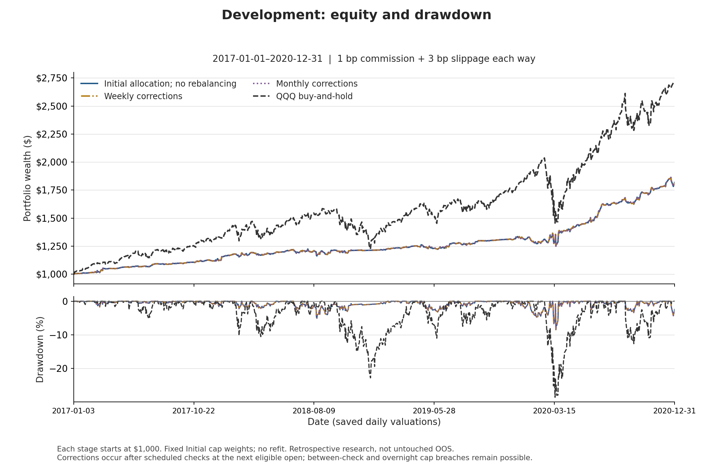
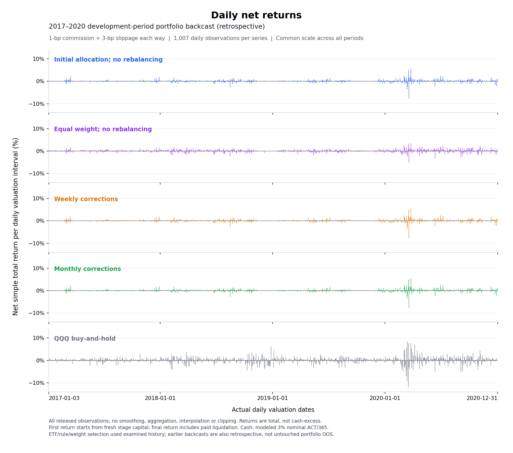
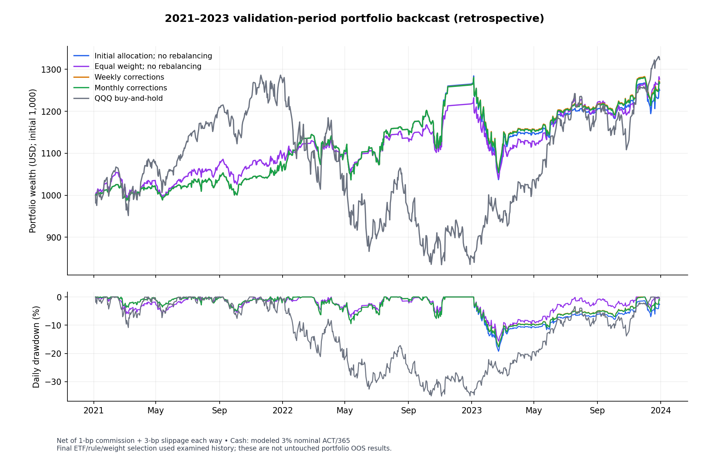
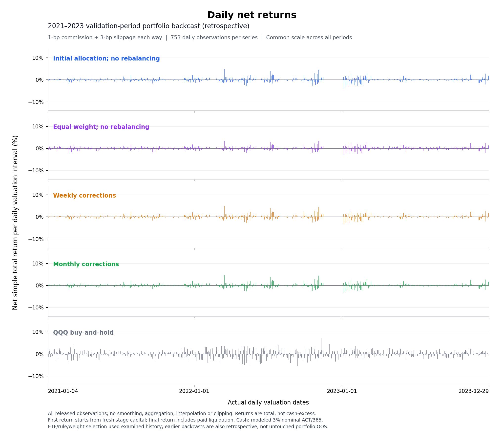
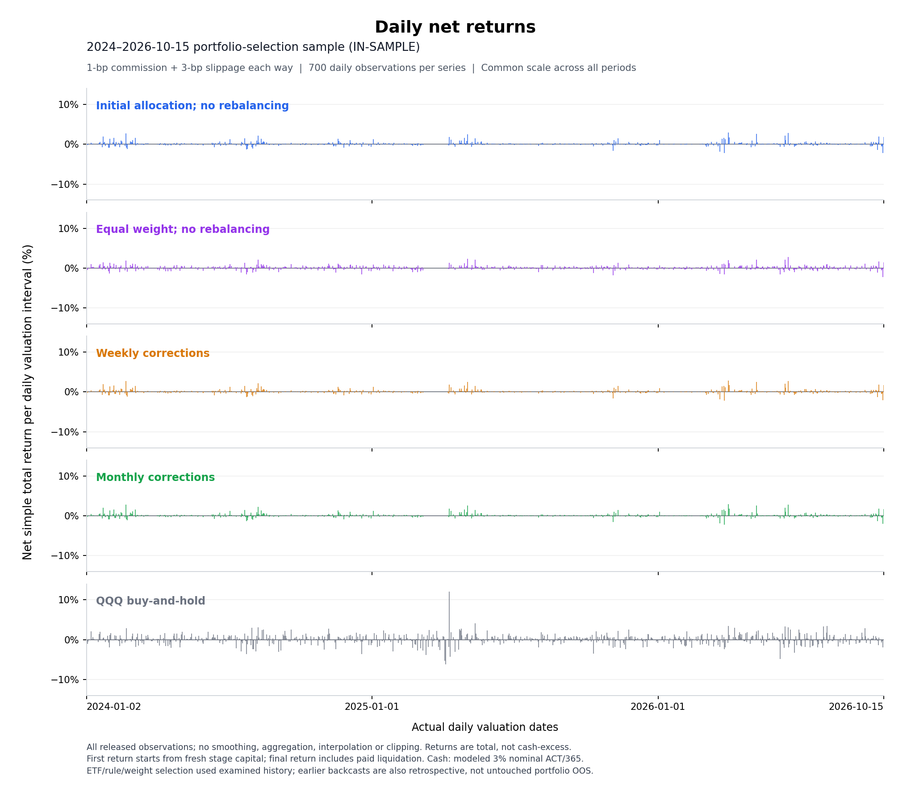

# ETF Strategy Portfolios

The comparison uses **GDX, FXI, QQQ, UNG and FDN**, with four portfolios:
**Initial allocation; no rebalancing**, **Equal weight; no rebalancing**,
**Weekly corrections** and **Monthly corrections**. The fitted starting vector
is identical across periods, correction frequencies and costs; equal weight
starts at 20% per sleeve in every period/cost and then drifts.

- [All three periods and four costs](report.md).
- [Full-precision results, alpha and betas](report.json).
- [Fitted-allocation performance](performance.csv), [full comparison](statistical_comparison.csv) and [matched QQQ/cash controls](controls.csv).
- [Saved-aggregate identity receipt](source_subset_audit.json) and [figure manifest](figures_manifest.json).
- [Strategy definitions](../../configs/selected_etf_strategies.json), [portfolio policy](../../configs/final_cap_rebalancing.json), [methods](../../docs/etf_methods.md) and [research scope/data sources](../../docs/etf_data_sources.md).

The original aggregate has **36 fitted-portfolio-cost-period rows** and
**15 distinct controls**. The released equal-weight comparison adds **12 rows**,
for **48 portfolio comparisons** across all three periods and four costs.
These are unchanged completed results, not a new fit, account replay or selection
exercise. The research scope and report terminology have been made consistent;
earlier snapshots are retained privately rather than mixed into this tree.

## Corrections and costs

At 17:00 New York on the last actual trading session of the ISO week or calendar
month, only an account-capital share above one-third queues a correction. It
executes at the next jointly eligible native bar open, after original actions,
dividend reinvestment and normal strategy fills. If the breach vanished, cancel.
Trim oversized accounts and redistribute proportionally to others' current
capital, respecting ETF/cash signals—not by restoring initial target weights.

A correction may move only cash and create no ETF order. Partial orders are not
extra completed strategy round trips. Direct cap costs mean cap-order fees and
slippage, not the total cost/return difference from no rebalancing. Paid normal,
cap and terminal ETF orders bear the stated costs; internal cash transfers and
the inherited fee-free dividend-reinvestment proxy do not. Cash earns 3% nominal
ACT/365 event-compounded; taxes and additional market impact are not modeled.

**The cap is not continuous or guaranteed at every daily close.** Between-check
drift and overnight gaps remain possible. It measures whole sleeve capital
including cash, not ETF exposure or risk contribution.

## Period reports and paired baseline plots

Each period report includes all four cost scenarios and keeps that period's
performance table, equity/drawdown plot and daily-return plot together. The
baseline figures use **1-bp commission + 3-bp slippage each way**. Five series
compare the fitted Initial allocation, Equal weight (no rebalancing), Weekly
corrections, Monthly corrections and QQQ buy-and-hold.

Daily-return panels show **net simple total returns (%)**, not cumulative
wealth, drawdown or cash-excess returns. The common vertical scale retains
all observations without smoothing, clipping or resampling. Underlying raw ETF
inputs and sleeve paths stay private; [derived aggregate returns](../reproducibility/README.md)
are public.

### Development-period backcast: 2017–2020

[Full development report](development_report.md).

### Validation-period backcast: 2021–2023

[Full validation report](validation_report.md).

### Portfolio-selection sample: 2024–October 15, 2026 (in-sample)

[Full portfolio-selection report](historical_OOS_report.md).

## Evidence boundary

This is **retrospective**, previously examined research—not untouched portfolio
OOS, an optimal-frequency claim or live trading instructions. The strategy and
portfolio accounts were independently audited before the publication cleanup.
Portable checks pin financial aggregates, configuration, rendered tables and
raster metadata; they do not reconstruct unavailable source data from a hash.
Exact financial reproduction requires the privately retained authenticated
input/event/account records. A [portable daily-return verifier](../../scripts/verify_daily_returns.py) now
reproduces summary statistics from the public derived returns, without raw
ETF data. This is not end-to-end signal/trade reproduction.

## Weight sensitivity and t-statistics

See the [full comparison](statistical_comparison.csv), including equal initial
20% weights with no rebalancing, IID and HAC mean-excess t-statistics. The
2024–2026 portfolio-selection sample is **in-sample**; HAC does not remove
selection bias. The baseline fitted static case has 34 round trips and 25.21%
mean ETF exposure. The [forward record](../paper_tracking/README.md) starts only
after the actual timestamped freeze.
