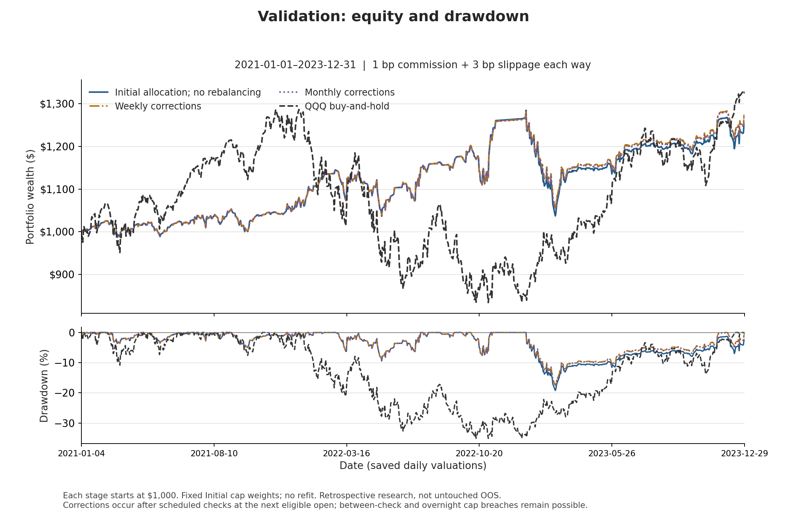
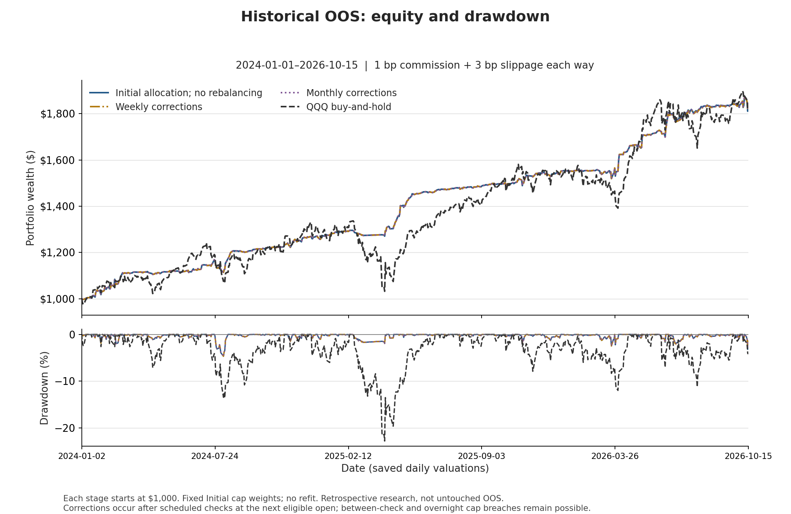

# Weekly and Monthly Cap-Triggered Rebalancing

The current comparison retains **Weekly corrections**, **Monthly corrections**
and the **Initial allocation / no-rebalancing benchmark**. Daily corrections are
excluded. The strategies are **GDX, FXI, QQQ, UNG and FDN**, with no bond ETF.
All three use the same exact saved Initial cap starting allocation, without
refitting, at every period and cost.

## Reports and evidence

- [Development, validation and historical OOS — all four costs](report.md).
- [Full-precision aggregate results, including alpha/betas](report.json).
- [Portfolio performance CSV](performance.csv) and [matched QQQ/cash controls](controls.csv).
- [Exact saved-subset audit](source_subset_audit.json) and [raster figure manifest](figures_manifest.json).
- [Policy and starting weights](../../configs/final_cap_rebalancing.json) and [methodology](../../docs/final_cap_rebalancing.md).

The publication contains **36 portfolio-cost-period rows**: three retained
policies/comparators × three periods × four costs. It also retains **15 distinct
controls**: twelve cost-matched QQQ buy-and-hold results and three identical-
across-cost cash controls. No retained metric or control changed when Daily
corrections were removed.

## How to interpret the cap

Only a breach at a scheduled 17:00 New York week/month-end check queues a
correction; execution waits for the next jointly eligible native bar open.
Trim above-cap sleeves and redistribute proportionally to the other sleeves'
**current capital**, respecting ETF/cash signals. This is not an automatic reset
to the initial weights. The one-third limit concerns sleeve capital including
cash, not ETF exposure or risk contribution.

**There is no continuous or daily-closing guarantee.** Between-check drift and
overnight gaps remain possible. A correction may consist solely of cash
transfers, so cap-execution counts can exceed paid ETF-order counts. Partial
orders are not extra completed strategy round trips.

Paid strategy, cap and terminal ETF orders bear the stated costs. The inherited
fee-free dividend-reinvestment proxy and internal cash transfers do not. Extra
cap costs mean direct cap-order commissions/slippage, not the total cost or
return difference versus the no-rebalancing comparator. Cash earns 3% nominal
ACT/365 event-compounded; taxes and additional market impact are not modeled.

## Baseline equity and drawdown

All panels use **1-bp commission plus 3-bp slippage each way**, fresh $1,000 stage
accounts, and exactly four curves: no rebalancing, Weekly, Monthly and QQQ
buy-and-hold. Numerical daily paths remain private; the figures are raster only.

## Audit boundary

These are **retrospective**, previously examined results—not untouched portfolio
OOS, an optimal-frequency claim or live trading instructions. The original
costed accounts were independently audited before this publication subset.
The detached receipt and verifier pin retained full-precision aggregates and
rendered tables; they do not reconstruct the unpublished original from a hash
or rerun its financial audit. Exact source comparison and financial reproduction
require the privately retained authenticated source/event/account records.

The older static cap fits are [historical archives](../final_no_bond_portfolios/README.md),
not the current correction policies. All original financial records remain unchanged.
