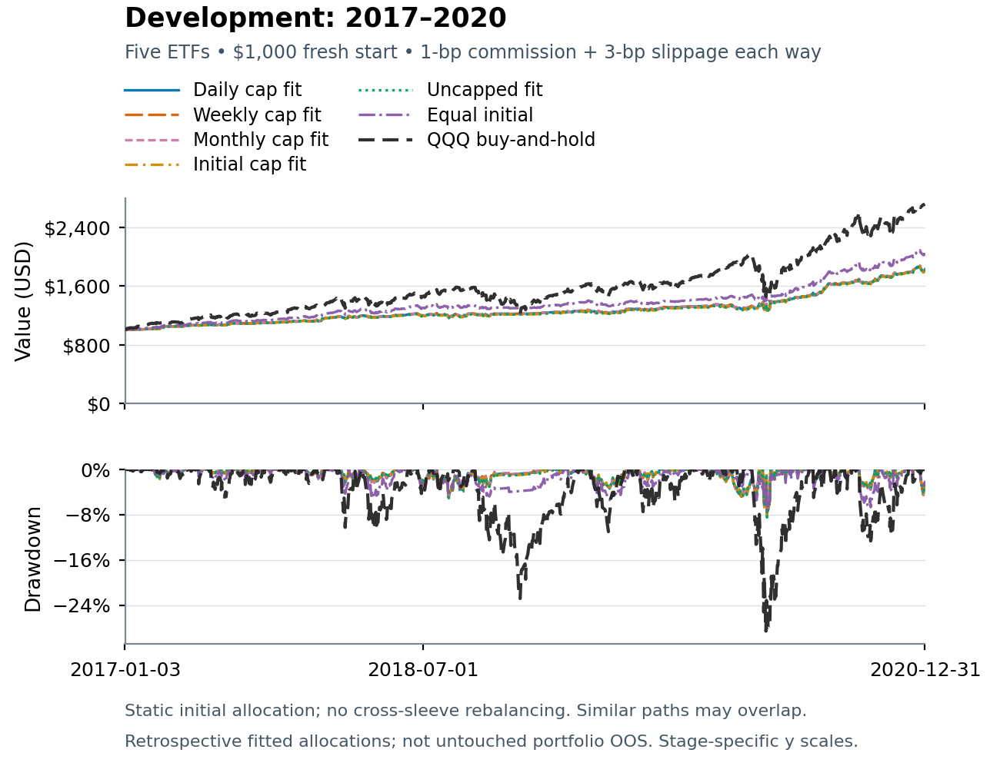
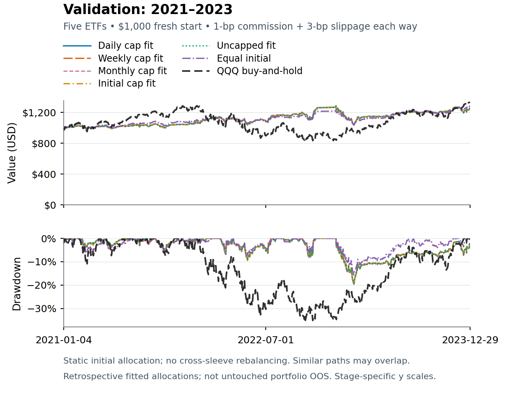
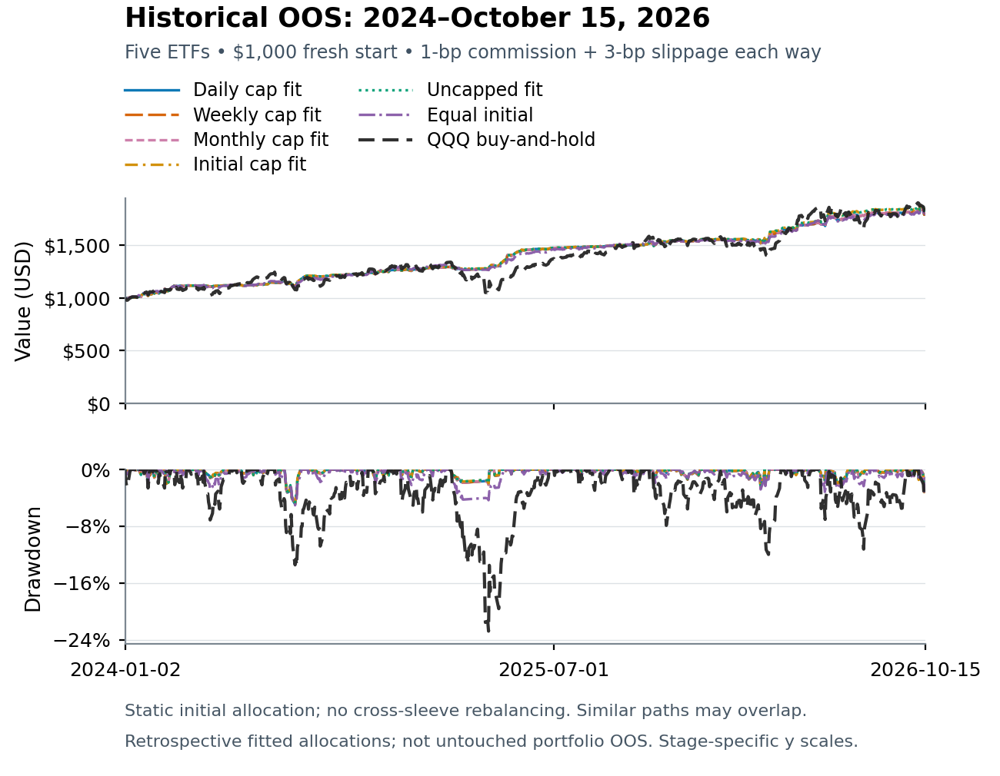

# Development 2017–2020 without bond ETFs

## Executive summary

The final strategy universe is GDX, FXI, QQQ, UNG and FDN. All bond ETFs are excluded from the active set. All five optimized portfolios were refitted using the examined 2024-01-01–2026-10-15 historical OOS window at baseline costs; Equal initial is a newly defined 20% allocation to each sleeve. These are six new allocation identities, not renormalized replacements silently substituted into old results.

Retrospective evidence only. Strategy selection, ETF pruning and all five portfolio fits use examined history. Earlier-period replay is hindsight-conditioned, not independent portfolio development or validation. The historical OOS name labels the parent strategy window, not an untouched portfolio test. No weight set is a live-trading recommendation or a certified global optimum.

| Baseline allocation or control | Cash excess Sharpe | CAGR | Daily max drawdown |
| --- | --- | --- | --- |
| Daily cap fit | 1.350 | 16.28% | -8.06% |
| Weekly cap fit | 1.350 | 16.28% | -8.06% |
| Monthly cap fit | 1.349 | 16.27% | -8.07% |
| Initial cap fit | 1.295 | 16.14% | -8.48% |
| Uncapped fit | 1.295 | 16.14% | -8.48% |
| Equal initial | 1.504 | 19.59% | -7.39% |
| QQQ buy and hold | 1.063 | 28.39% | -28.56% |

Scored 2017-01-01 to 2020-12-31; 1007 daily return observations; 3.995376712329 ACT365 years. Every account starts fresh at $1,000. The study endpoint remains 15 October 2026.

## New initial strategy allocations

| Strategy sleeve | Daily cap fit | Weekly cap fit | Monthly cap fit | Initial cap fit | Uncapped fit | Equal initial |
| --- | --- | --- | --- | --- | --- | --- |
| GDX | 24.545438% | 24.545438% | 24.625287% | 29.051308% | 29.051308% | 20.000000% |
| FXI | 30.140363% | 30.140363% | 30.088349% | 27.991974% | 27.991974% | 20.000000% |
| QQQ | 7.034118% | 7.034117% | 7.108984% | 6.304493% | 6.304493% | 20.000000% |
| UNG | 27.700691% | 27.700691% | 27.676395% | 26.729328% | 26.729328% | 20.000000% |
| FDN | 10.579390% | 10.579391% | 10.500986% | 9.922896% | 9.922896% | 20.000000% |

Weights allocate saved strategy-account wealth, including idle cash, not permanent holdings of the named ETFs. Capital is assigned once; each sleeve’s share later drifts with its wealth. There are no daily, weekly or monthly portfolio transfer or rebalance trades. The same exact full-precision weights are replayed in every period and all four costs.

## What the different caps mean

Daily cap fit constrains initial weights and every historical OOS daily sleeve-capital share to at most one-third. Weekly cap fit and Monthly cap fit constrain initial weights and the last observed New York trading valuation in each ISO week or calendar month, respectively, including the terminal incomplete week/month at the fixed cutoff. Each fit constrains all four cost scenarios. Between-checkpoint daily shares may exceed one-third without triggering any trade.

Initial cap fit applies one-third only to starting allocations; there is no later cap enforcement. Uncapped fit and Equal initial have no ongoing cap. Replayed development and validation concentration diagnostics are observations, not newly fitted constraints. Weekly and monthly checkpoint sets are not generally nested, so one cannot infer a theoretical ordering between their optimum Sharpes. All numerical fits are best-found, not globally certified, and no cap promises future or intraday enforcement.

## Baseline equity and daily drawdown

Six new static initial allocations and cost-matched passive QQQ, each starting at $1,000. Baseline costs are 1-bp commission plus 3-bp slippage each way. Saved-path raster includes initial balance and paid terminal liquidation; no numerical daily series is embedded.

## All four execution cost scenarios

Each purchase and sale pays 1-bp commission plus one-way slippage of 1, 3, 10 or 25 bps. Baseline is 3-bp slippage, or 4 bps total per side. Cost-matched passive QQQ and matched cash are retained at every cost. Neither signals nor weights are refitted when costs or replay periods change.

### 1 bp slippage each way

| Allocation or control | Sharpe | CAGR | Net volatility | Daily max DD | Final $1,000 |
| --- | --- | --- | --- | --- | --- |
| Daily cap fit | 1.358 | 16.37% | 9.28% | -8.06% | $1,832.65 |
| Weekly cap fit | 1.358 | 16.37% | 9.28% | -8.06% | $1,832.65 |
| Monthly cap fit | 1.357 | 16.37% | 9.28% | -8.07% | $1,832.42 |
| Initial cap fit | 1.303 | 16.24% | 9.60% | -8.48% | $1,824.18 |
| Uncapped fit | 1.303 | 16.24% | 9.60% | -8.48% | $1,824.18 |
| Equal initial | 1.511 | 19.68% | 10.26% | -7.36% | $2,049.94 |
| QQQ buy and hold | 1.063 | 28.40% | 23.26% | -28.56% | $2,715.19 |
| Matched cash | Undefined | 3.05% | 0.11% | 0.00% | $1,127.33 |

### 3 bp slippage each way

| Allocation or control | Sharpe | CAGR | Net volatility | Daily max DD | Final $1,000 |
| --- | --- | --- | --- | --- | --- |
| Daily cap fit | 1.350 | 16.28% | 9.27% | -8.06% | $1,826.74 |
| Weekly cap fit | 1.350 | 16.28% | 9.27% | -8.06% | $1,826.74 |
| Monthly cap fit | 1.349 | 16.27% | 9.28% | -8.07% | $1,826.52 |
| Initial cap fit | 1.295 | 16.14% | 9.60% | -8.48% | $1,818.13 |
| Uncapped fit | 1.295 | 16.14% | 9.60% | -8.48% | $1,818.13 |
| Equal initial | 1.504 | 19.59% | 10.26% | -7.39% | $2,044.00 |
| QQQ buy and hold | 1.063 | 28.39% | 23.26% | -28.56% | $2,714.11 |
| Matched cash | Undefined | 3.05% | 0.11% | 0.00% | $1,127.33 |

### 10 bp slippage each way

| Allocation or control | Sharpe | CAGR | Net volatility | Daily max DD | Final $1,000 |
| --- | --- | --- | --- | --- | --- |
| Daily cap fit | 1.321 | 15.95% | 9.26% | -8.07% | $1,806.24 |
| Weekly cap fit | 1.321 | 15.95% | 9.26% | -8.07% | $1,806.24 |
| Monthly cap fit | 1.320 | 15.95% | 9.27% | -8.08% | $1,806.01 |
| Initial cap fit | 1.267 | 15.80% | 9.58% | -8.49% | $1,797.14 |
| Uncapped fit | 1.267 | 15.80% | 9.58% | -8.49% | $1,797.14 |
| Equal initial | 1.479 | 19.29% | 10.26% | -7.49% | $2,023.35 |
| QQQ buy and hold | 1.061 | 28.35% | 23.26% | -28.56% | $2,710.31 |
| Matched cash | Undefined | 3.05% | 0.11% | 0.00% | $1,127.33 |

### 25 bp slippage each way

| Allocation or control | Sharpe | CAGR | Net volatility | Daily max DD | Final $1,000 |
| --- | --- | --- | --- | --- | --- |
| Daily cap fit | 1.259 | 15.25% | 9.23% | -8.08% | $1,763.15 |
| Weekly cap fit | 1.259 | 15.25% | 9.23% | -8.08% | $1,763.15 |
| Monthly cap fit | 1.258 | 15.25% | 9.24% | -8.09% | $1,762.91 |
| Initial cap fit | 1.205 | 15.08% | 9.55% | -8.51% | $1,753.02 |
| Uncapped fit | 1.205 | 15.08% | 9.55% | -8.51% | $1,753.02 |
| Equal initial | 1.426 | 18.64% | 10.26% | -7.71% | $1,979.88 |
| QQQ buy and hold | 1.058 | 28.25% | 23.26% | -28.56% | $2,702.19 |
| Matched cash | Undefined | 3.05% | 0.11% | 0.00% | $1,127.33 |

## QQQ single factor attribution

Same-stage, same-cost passive QQQ is the explanatory factor. Alpha is annual arithmetic percent, not compound growth. Betas and R squared are descriptive fitted quantities, with no significance or causal-skill claim.

| Slippage bp | Allocation | Alpha annual | QQQ beta | R squared |
| --- | --- | --- | --- | --- |
| 1 | Daily cap fit | 6.96% | 0.2278 | 32.64% |
| 1 | Weekly cap fit | 6.96% | 0.2278 | 32.64% |
| 1 | Monthly cap fit | 6.96% | 0.2278 | 32.59% |
| 1 | Initial cap fit | 7.17% | 0.2160 | 27.39% |
| 1 | Uncapped fit | 7.17% | 0.2160 | 27.39% |
| 1 | Equal initial | 7.64% | 0.3177 | 51.93% |
| 3 | Daily cap fit | 6.88% | 0.2279 | 32.69% |
| 3 | Weekly cap fit | 6.88% | 0.2279 | 32.69% |
| 3 | Monthly cap fit | 6.88% | 0.2279 | 32.64% |
| 3 | Initial cap fit | 7.09% | 0.2161 | 27.44% |
| 3 | Uncapped fit | 7.09% | 0.2161 | 27.44% |
| 3 | Equal initial | 7.57% | 0.3178 | 51.97% |
| 10 | Daily cap fit | 6.60% | 0.2282 | 32.88% |
| 10 | Weekly cap fit | 6.60% | 0.2282 | 32.88% |
| 10 | Monthly cap fit | 6.59% | 0.2282 | 32.83% |
| 10 | Initial cap fit | 6.79% | 0.2164 | 27.61% |
| 10 | Uncapped fit | 6.79% | 0.2164 | 27.61% |
| 10 | Equal initial | 7.31% | 0.3182 | 52.11% |
| 25 | Daily cap fit | 5.99% | 0.2289 | 33.26% |
| 25 | Weekly cap fit | 5.99% | 0.2289 | 33.26% |
| 25 | Monthly cap fit | 5.99% | 0.2289 | 33.22% |
| 25 | Initial cap fit | 6.17% | 0.2171 | 27.98% |
| 25 | Uncapped fit | 6.17% | 0.2171 | 27.98% |
| 25 | Equal initial | 6.77% | 0.3191 | 52.39% |

## Joint five passive ETF factor attribution

### 1 bp slippage each way

| Allocation | GDX beta | FXI beta | QQQ beta | UNG beta | FDN beta | Alpha annual | R squared |
| --- | --- | --- | --- | --- | --- | --- | --- |
| Daily cap fit | 0.0924 | 0.1008 | 0.0431 | 0.0372 | 0.0909 | 7.70% | 54.20% |
| Weekly cap fit | 0.0924 | 0.1008 | 0.0431 | 0.0372 | 0.0909 | 7.70% | 54.20% |
| Monthly cap fit | 0.0927 | 0.1008 | 0.0439 | 0.0372 | 0.0900 | 7.69% | 54.19% |
| Initial cap fit | 0.1083 | 0.1011 | 0.0366 | 0.0367 | 0.0822 | 7.69% | 52.24% |
| Uncapped fit | 0.1083 | 0.1011 | 0.0366 | 0.0367 | 0.0822 | 7.69% | 52.24% |
| Equal initial | 0.0756 | 0.0636 | 0.0806 | 0.0243 | 0.1751 | 7.93% | 63.81% |

### 3 bp slippage each way

| Allocation | GDX beta | FXI beta | QQQ beta | UNG beta | FDN beta | Alpha annual | R squared |
| --- | --- | --- | --- | --- | --- | --- | --- |
| Daily cap fit | 0.0924 | 0.1008 | 0.0431 | 0.0372 | 0.0910 | 7.62% | 54.25% |
| Weekly cap fit | 0.0924 | 0.1008 | 0.0431 | 0.0372 | 0.0910 | 7.62% | 54.25% |
| Monthly cap fit | 0.0926 | 0.1008 | 0.0440 | 0.0372 | 0.0901 | 7.61% | 54.24% |
| Initial cap fit | 0.1082 | 0.1010 | 0.0366 | 0.0367 | 0.0823 | 7.60% | 52.29% |
| Uncapped fit | 0.1082 | 0.1010 | 0.0366 | 0.0367 | 0.0823 | 7.60% | 52.29% |
| Equal initial | 0.0755 | 0.0635 | 0.0807 | 0.0243 | 0.1752 | 7.86% | 63.84% |

### 10 bp slippage each way

| Allocation | GDX beta | FXI beta | QQQ beta | UNG beta | FDN beta | Alpha annual | R squared |
| --- | --- | --- | --- | --- | --- | --- | --- |
| Daily cap fit | 0.0921 | 0.1008 | 0.0431 | 0.0372 | 0.0914 | 7.34% | 54.43% |
| Weekly cap fit | 0.0921 | 0.1008 | 0.0431 | 0.0372 | 0.0914 | 7.34% | 54.43% |
| Monthly cap fit | 0.0924 | 0.1007 | 0.0440 | 0.0372 | 0.0904 | 7.34% | 54.42% |
| Initial cap fit | 0.1080 | 0.1010 | 0.0367 | 0.0367 | 0.0826 | 7.32% | 52.46% |
| Uncapped fit | 0.1080 | 0.1010 | 0.0367 | 0.0367 | 0.0826 | 7.32% | 52.46% |
| Equal initial | 0.0753 | 0.0633 | 0.0808 | 0.0243 | 0.1757 | 7.61% | 63.93% |

### 25 bp slippage each way

| Allocation | GDX beta | FXI beta | QQQ beta | UNG beta | FDN beta | Alpha annual | R squared |
| --- | --- | --- | --- | --- | --- | --- | --- |
| Daily cap fit | 0.0916 | 0.1007 | 0.0432 | 0.0372 | 0.0921 | 6.75% | 54.79% |
| Weekly cap fit | 0.0916 | 0.1007 | 0.0432 | 0.0372 | 0.0921 | 6.75% | 54.79% |
| Monthly cap fit | 0.0919 | 0.1006 | 0.0441 | 0.0371 | 0.0912 | 6.75% | 54.78% |
| Initial cap fit | 0.1074 | 0.1008 | 0.0369 | 0.0367 | 0.0833 | 6.71% | 52.81% |
| Uncapped fit | 0.1074 | 0.1008 | 0.0369 | 0.0367 | 0.0833 | 6.71% | 52.81% |
| Equal initial | 0.0748 | 0.0629 | 0.0810 | 0.0243 | 0.1768 | 7.08% | 64.13% |

## Checkpoint and daily capital share diagnostics

Each row describes the same saved portfolio path at one checkpoint schedule. A breach day means at least one sleeve exceeds one-third at that valuation, not the number of offending sleeves. Between-checkpoint breach days exclude the scheduled checkpoints. Initial and uncapped/equal comparisons have no promised ongoing limit; backward replay breaches of new fitted limits are retained rather than repaired.

### 1 bp slippage diagnostics

| Allocation | Checks | Count | Peak check | Check breach days | Peak daily | Daily breach days | Between days |
| --- | --- | --- | --- | --- | --- | --- | --- |
| Daily cap fit | daily | 1007 | 30.1382% | 0 | 30.1382% | 0 | 0 |
| Daily cap fit | weekly | 209 | 30.0182% | 0 | 30.1382% | 0 | 0 |
| Daily cap fit | monthly | 48 | 29.9159% | 0 | 30.1382% | 0 | 0 |
| Weekly cap fit | daily | 1007 | 30.1382% | 0 | 30.1382% | 0 | 0 |
| Weekly cap fit | weekly | 209 | 30.0182% | 0 | 30.1382% | 0 | 0 |
| Weekly cap fit | monthly | 48 | 29.9159% | 0 | 30.1382% | 0 | 0 |
| Monthly cap fit | daily | 1007 | 30.1207% | 0 | 30.1207% | 0 | 0 |
| Monthly cap fit | weekly | 209 | 29.9664% | 0 | 30.1207% | 0 | 0 |
| Monthly cap fit | monthly | 48 | 29.8643% | 0 | 30.1207% | 0 | 0 |
| Initial cap fit | daily | 1007 | 29.4304% | 0 | 29.4304% | 0 | 0 |
| Initial cap fit | weekly | 209 | 29.0971% | 0 | 29.4304% | 0 | 0 |
| Initial cap fit | monthly | 48 | 28.8519% | 0 | 29.4304% | 0 | 0 |
| Uncapped fit | daily | 1007 | 29.4304% | 0 | 29.4304% | 0 | 0 |
| Uncapped fit | weekly | 209 | 29.0971% | 0 | 29.4304% | 0 | 0 |
| Uncapped fit | monthly | 48 | 28.8519% | 0 | 29.4304% | 0 | 0 |
| Equal initial | daily | 1007 | 28.5060% | 0 | 28.5060% | 0 | 0 |
| Equal initial | weekly | 209 | 28.0654% | 0 | 28.5060% | 0 | 0 |
| Equal initial | monthly | 48 | 27.8795% | 0 | 28.5060% | 0 | 0 |

### 3 bp slippage diagnostics

| Allocation | Checks | Count | Peak check | Check breach days | Peak daily | Daily breach days | Between days |
| --- | --- | --- | --- | --- | --- | --- | --- |
| Daily cap fit | daily | 1007 | 30.1386% | 0 | 30.1386% | 0 | 0 |
| Daily cap fit | weekly | 209 | 30.0193% | 0 | 30.1386% | 0 | 0 |
| Daily cap fit | monthly | 48 | 29.9170% | 0 | 30.1386% | 0 | 0 |
| Weekly cap fit | daily | 1007 | 30.1386% | 0 | 30.1386% | 0 | 0 |
| Weekly cap fit | weekly | 209 | 30.0193% | 0 | 30.1386% | 0 | 0 |
| Weekly cap fit | monthly | 48 | 29.9170% | 0 | 30.1386% | 0 | 0 |
| Monthly cap fit | daily | 1007 | 30.1211% | 0 | 30.1211% | 0 | 0 |
| Monthly cap fit | weekly | 209 | 29.9675% | 0 | 30.1211% | 0 | 0 |
| Monthly cap fit | monthly | 48 | 29.8654% | 0 | 30.1211% | 0 | 0 |
| Initial cap fit | daily | 1007 | 29.4323% | 0 | 29.4323% | 0 | 0 |
| Initial cap fit | weekly | 209 | 29.1056% | 0 | 29.4323% | 0 | 0 |
| Initial cap fit | monthly | 48 | 28.8529% | 0 | 29.4323% | 0 | 0 |
| Uncapped fit | daily | 1007 | 29.4323% | 0 | 29.4323% | 0 | 0 |
| Uncapped fit | weekly | 209 | 29.1056% | 0 | 29.4323% | 0 | 0 |
| Uncapped fit | monthly | 48 | 28.8529% | 0 | 29.4323% | 0 | 0 |
| Equal initial | daily | 1007 | 28.5150% | 0 | 28.5150% | 0 | 0 |
| Equal initial | weekly | 209 | 28.0811% | 0 | 28.5150% | 0 | 0 |
| Equal initial | monthly | 48 | 27.8886% | 0 | 28.5150% | 0 | 0 |

### 10 bp slippage diagnostics

| Allocation | Checks | Count | Peak check | Check breach days | Peak daily | Daily breach days | Between days |
| --- | --- | --- | --- | --- | --- | --- | --- |
| Daily cap fit | daily | 1007 | 30.1399% | 0 | 30.1399% | 0 | 0 |
| Daily cap fit | weekly | 209 | 30.0230% | 0 | 30.1399% | 0 | 0 |
| Daily cap fit | monthly | 48 | 29.9208% | 0 | 30.1399% | 0 | 0 |
| Weekly cap fit | daily | 1007 | 30.1399% | 0 | 30.1399% | 0 | 0 |
| Weekly cap fit | weekly | 209 | 30.0230% | 0 | 30.1399% | 0 | 0 |
| Weekly cap fit | monthly | 48 | 29.9208% | 0 | 30.1399% | 0 | 0 |
| Monthly cap fit | daily | 1007 | 30.1224% | 0 | 30.1224% | 0 | 0 |
| Monthly cap fit | weekly | 209 | 29.9712% | 0 | 30.1224% | 0 | 0 |
| Monthly cap fit | monthly | 48 | 29.8692% | 0 | 30.1224% | 0 | 0 |
| Initial cap fit | daily | 1007 | 29.4388% | 0 | 29.4388% | 0 | 0 |
| Initial cap fit | weekly | 209 | 29.1353% | 0 | 29.4388% | 0 | 0 |
| Initial cap fit | monthly | 48 | 28.8563% | 0 | 29.4388% | 0 | 0 |
| Uncapped fit | daily | 1007 | 29.4388% | 0 | 29.4388% | 0 | 0 |
| Uncapped fit | weekly | 209 | 29.1353% | 0 | 29.4388% | 0 | 0 |
| Uncapped fit | monthly | 48 | 28.8563% | 0 | 29.4388% | 0 | 0 |
| Equal initial | daily | 1007 | 28.5466% | 0 | 28.5466% | 0 | 0 |
| Equal initial | weekly | 209 | 28.1358% | 0 | 28.5466% | 0 | 0 |
| Equal initial | monthly | 48 | 27.9328% | 0 | 28.5466% | 0 | 0 |

### 25 bp slippage diagnostics

| Allocation | Checks | Count | Peak check | Check breach days | Peak daily | Daily breach days | Between days |
| --- | --- | --- | --- | --- | --- | --- | --- |
| Daily cap fit | daily | 1007 | 30.1423% | 0 | 30.1423% | 0 | 0 |
| Daily cap fit | weekly | 209 | 30.0311% | 0 | 30.1423% | 0 | 0 |
| Daily cap fit | monthly | 48 | 29.9290% | 0 | 30.1423% | 0 | 0 |
| Weekly cap fit | daily | 1007 | 30.1423% | 0 | 30.1423% | 0 | 0 |
| Weekly cap fit | weekly | 209 | 30.0311% | 0 | 30.1423% | 0 | 0 |
| Weekly cap fit | monthly | 48 | 29.9290% | 0 | 30.1423% | 0 | 0 |
| Monthly cap fit | daily | 1007 | 30.1249% | 0 | 30.1249% | 0 | 0 |
| Monthly cap fit | weekly | 209 | 29.9793% | 0 | 30.1249% | 0 | 0 |
| Monthly cap fit | monthly | 48 | 29.8773% | 0 | 30.1249% | 0 | 0 |
| Initial cap fit | daily | 1007 | 29.4524% | 0 | 29.4524% | 0 | 0 |
| Initial cap fit | weekly | 209 | 29.1986% | 0 | 29.4524% | 0 | 0 |
| Initial cap fit | monthly | 48 | 28.8636% | 0 | 29.4524% | 0 | 0 |
| Uncapped fit | daily | 1007 | 29.4524% | 0 | 29.4524% | 0 | 0 |
| Uncapped fit | weekly | 209 | 29.1986% | 0 | 29.4524% | 0 | 0 |
| Uncapped fit | monthly | 48 | 28.8636% | 0 | 29.4524% | 0 | 0 |
| Equal initial | daily | 1007 | 28.6137% | 0 | 28.6137% | 0 | 0 |
| Equal initial | weekly | 209 | 28.2531% | 0 | 28.6137% | 0 | 0 |
| Equal initial | monthly | 48 | 28.0508% | 0 | 28.6137% | 0 | 0 |

## Active strategy and portfolio correlations

All matrices use the same stage’s daily net account returns, including flat/cash periods, at the stated costs. The seven-series portfolio matrix adds matched passive QQQ to the six new allocations. These are sample correlations, not future diversification guarantees, passive-factor correlations or a pairs-trading strategy test. Closely related fitted allocations may have very high correlations.

### 1 bp slippage active strategy correlations

| Strategy | GDX | FXI | QQQ | UNG | FDN |
| --- | --- | --- | --- | --- | --- |
| GDX | 1.0000 | 0.0925 | 0.0668 | 0.0208 | 0.0562 |
| FXI | 0.0925 | 1.0000 | 0.2105 | 0.0061 | 0.1200 |
| QQQ | 0.0668 | 0.2105 | 1.0000 | 0.0231 | 0.7793 |
| UNG | 0.0208 | 0.0061 | 0.0231 | 1.0000 | 0.0319 |
| FDN | 0.0562 | 0.1200 | 0.7793 | 0.0319 | 1.0000 |

### 1 bp slippage portfolio correlations

| Portfolio | Daily cap fit | Weekly cap fit | Monthly cap fit | Initial cap fit | Uncapped fit | Equal initial | QQQ buy and hold |
| --- | --- | --- | --- | --- | --- | --- | --- |
| Daily cap fit | 1.0000 | 1.0000 | 1.0000 | 0.9948 | 0.9948 | 0.9017 | 0.5711 |
| Weekly cap fit | 1.0000 | 1.0000 | 1.0000 | 0.9948 | 0.9948 | 0.9017 | 0.5711 |
| Monthly cap fit | 1.0000 | 1.0000 | 1.0000 | 0.9950 | 0.9950 | 0.9015 | 0.5707 |
| Initial cap fit | 0.9948 | 0.9948 | 0.9950 | 1.0000 | 1.0000 | 0.8793 | 0.5232 |
| Uncapped fit | 0.9948 | 0.9948 | 0.9950 | 1.0000 | 1.0000 | 0.8793 | 0.5232 |
| Equal initial | 0.9017 | 0.9017 | 0.9015 | 0.8793 | 0.8793 | 1.0000 | 0.7205 |
| QQQ buy and hold | 0.5711 | 0.5711 | 0.5707 | 0.5232 | 0.5232 | 0.7205 | 1.0000 |

### 3 bp slippage active strategy correlations

| Strategy | GDX | FXI | QQQ | UNG | FDN |
| --- | --- | --- | --- | --- | --- |
| GDX | 1.0000 | 0.0926 | 0.0667 | 0.0208 | 0.0561 |
| FXI | 0.0926 | 1.0000 | 0.2106 | 0.0059 | 0.1198 |
| QQQ | 0.0667 | 0.2106 | 1.0000 | 0.0229 | 0.7790 |
| UNG | 0.0208 | 0.0059 | 0.0229 | 1.0000 | 0.0318 |
| FDN | 0.0561 | 0.1198 | 0.7790 | 0.0318 | 1.0000 |

### 3 bp slippage portfolio correlations

| Portfolio | Daily cap fit | Weekly cap fit | Monthly cap fit | Initial cap fit | Uncapped fit | Equal initial | QQQ buy and hold |
| --- | --- | --- | --- | --- | --- | --- | --- |
| Daily cap fit | 1.0000 | 1.0000 | 1.0000 | 0.9948 | 0.9948 | 0.9016 | 0.5716 |
| Weekly cap fit | 1.0000 | 1.0000 | 1.0000 | 0.9948 | 0.9948 | 0.9016 | 0.5716 |
| Monthly cap fit | 1.0000 | 1.0000 | 1.0000 | 0.9950 | 0.9950 | 0.9014 | 0.5712 |
| Initial cap fit | 0.9948 | 0.9948 | 0.9950 | 1.0000 | 1.0000 | 0.8793 | 0.5237 |
| Uncapped fit | 0.9948 | 0.9948 | 0.9950 | 1.0000 | 1.0000 | 0.8793 | 0.5237 |
| Equal initial | 0.9016 | 0.9016 | 0.9014 | 0.8793 | 0.8793 | 1.0000 | 0.7208 |
| QQQ buy and hold | 0.5716 | 0.5716 | 0.5712 | 0.5237 | 0.5237 | 0.7208 | 1.0000 |

### 10 bp slippage active strategy correlations

| Strategy | GDX | FXI | QQQ | UNG | FDN |
| --- | --- | --- | --- | --- | --- |
| GDX | 1.0000 | 0.0930 | 0.0667 | 0.0206 | 0.0558 |
| FXI | 0.0930 | 1.0000 | 0.2110 | 0.0050 | 0.1191 |
| QQQ | 0.0667 | 0.2110 | 1.0000 | 0.0222 | 0.7780 |
| UNG | 0.0206 | 0.0050 | 0.0222 | 1.0000 | 0.0313 |
| FDN | 0.0558 | 0.1191 | 0.7780 | 0.0313 | 1.0000 |

### 10 bp slippage portfolio correlations

| Portfolio | Daily cap fit | Weekly cap fit | Monthly cap fit | Initial cap fit | Uncapped fit | Equal initial | QQQ buy and hold |
| --- | --- | --- | --- | --- | --- | --- | --- |
| Daily cap fit | 1.0000 | 1.0000 | 1.0000 | 0.9948 | 0.9948 | 0.9014 | 0.5732 |
| Weekly cap fit | 1.0000 | 1.0000 | 1.0000 | 0.9948 | 0.9948 | 0.9014 | 0.5732 |
| Monthly cap fit | 1.0000 | 1.0000 | 1.0000 | 0.9950 | 0.9950 | 0.9012 | 0.5728 |
| Initial cap fit | 0.9948 | 0.9948 | 0.9950 | 1.0000 | 1.0000 | 0.8790 | 0.5253 |
| Uncapped fit | 0.9948 | 0.9948 | 0.9950 | 1.0000 | 1.0000 | 0.8790 | 0.5253 |
| Equal initial | 0.9014 | 0.9014 | 0.9012 | 0.8790 | 0.8790 | 1.0000 | 0.7218 |
| QQQ buy and hold | 0.5732 | 0.5732 | 0.5728 | 0.5253 | 0.5253 | 0.7218 | 1.0000 |

### 25 bp slippage active strategy correlations

| Strategy | GDX | FXI | QQQ | UNG | FDN |
| --- | --- | --- | --- | --- | --- |
| GDX | 1.0000 | 0.0936 | 0.0665 | 0.0203 | 0.0551 |
| FXI | 0.0936 | 1.0000 | 0.2118 | 0.0032 | 0.1175 |
| QQQ | 0.0665 | 0.2118 | 1.0000 | 0.0207 | 0.7756 |
| UNG | 0.0203 | 0.0032 | 0.0207 | 1.0000 | 0.0302 |
| FDN | 0.0551 | 0.1175 | 0.7756 | 0.0302 | 1.0000 |

### 25 bp slippage portfolio correlations

| Portfolio | Daily cap fit | Weekly cap fit | Monthly cap fit | Initial cap fit | Uncapped fit | Equal initial | QQQ buy and hold |
| --- | --- | --- | --- | --- | --- | --- | --- |
| Daily cap fit | 1.0000 | 1.0000 | 1.0000 | 0.9948 | 0.9948 | 0.9008 | 0.5766 |
| Weekly cap fit | 1.0000 | 1.0000 | 1.0000 | 0.9948 | 0.9948 | 0.9008 | 0.5766 |
| Monthly cap fit | 1.0000 | 1.0000 | 1.0000 | 0.9950 | 0.9950 | 0.9007 | 0.5762 |
| Initial cap fit | 0.9948 | 0.9948 | 0.9950 | 1.0000 | 1.0000 | 0.8784 | 0.5288 |
| Uncapped fit | 0.9948 | 0.9948 | 0.9950 | 1.0000 | 1.0000 | 0.8784 | 0.5288 |
| Equal initial | 0.9008 | 0.9008 | 0.9007 | 0.8784 | 0.8784 | 1.0000 | 0.7237 |
| QQQ buy and hold | 0.5766 | 0.5766 | 0.5762 | 0.5288 | 0.5288 | 0.7237 | 1.0000 |

## Methods and limitations

Portfolio wealth is V(c,t) = sum_i w(i)E(c,t,i), with each saved sleeve normalized to E(c,0,i)=1, V(c,0)=1 and sum_i w(i)=1. Daily returns are V(c,t)/V(c,t−1)−1, not constant-weight daily return averages. Each stage starts independently with $1,000; holdings, orders, streaks and wealth do not carry across stages. Only causal feature history carries.

Cash is 3% nominal ACT/365 event-compounded, not 3% APY. Cash-excess Sharpe is sqrt(252) times mean daily net return minus matched cash return, divided by the sample standard deviation of that difference with ddof 1. It does not mean excess over buy-and-hold. Net volatility is the annualized sample standard deviation of daily net returns. CAGR uses each actual initial-to-terminal ACT/365 clock; daily drawdown includes the initial balance and is not an intraday measure. Undefined Sharpe/correlations are retained, not replaced with zero.

The original strategy identities, daily causal indicators, native half-hour observations, shared three-trading-hour/seven-consecutive-check confirmation, next eligible observed bar-open execution, corporate actions, distributions, embedded costs and paid terminal liquidation are unchanged. No original market data or execution engine was rerun for this allocation study. No new combined trade count is inferred from the independent sleeves.

Attribution uses portfolio net cash-excess returns and cost-matched passive QQQ or all five passive ETF cash-excess returns with an intercept. Joint partial betas are not weights, causal effects or short positions. Annual arithmetic alpha is 252 times the daily intercept, not CAGR. R squared is descriptive, not a significance or predictive-skill claim. Active strategy correlations use net daily account returns including cash/flat periods; they are not passive factor correlations.

Older six-sleeve calculations and the original four-portfolio class-project reports remain preserved archives. Their BND cash-rich sleeve is excluded from every active allocation, correlation matrix and passive-factor regression here. The standalone Maximum CAGR/100%-GDX portfolio remains excluded; GDX remains an underlying strategy sleeve. No earlier result is silently overwritten.

---

# Validation 2021–2023 without bond ETFs

## Executive summary

The final strategy universe is GDX, FXI, QQQ, UNG and FDN. All bond ETFs are excluded from the active set. All five optimized portfolios were refitted using the examined 2024-01-01–2026-10-15 historical OOS window at baseline costs; Equal initial is a newly defined 20% allocation to each sleeve. These are six new allocation identities, not renormalized replacements silently substituted into old results.

Retrospective evidence only. Strategy selection, ETF pruning and all five portfolio fits use examined history. Earlier-period replay is hindsight-conditioned, not independent portfolio development or validation. The historical OOS name labels the parent strategy window, not an untouched portfolio test. No weight set is a live-trading recommendation or a certified global optimum.

| Baseline allocation or control | Cash excess Sharpe | CAGR | Daily max drawdown |
| --- | --- | --- | --- |
| Daily cap fit | 0.417 | 7.83% | -19.57% |
| Weekly cap fit | 0.417 | 7.83% | -19.57% |
| Monthly cap fit | 0.418 | 7.83% | -19.56% |
| Initial cap fit | 0.419 | 7.77% | -19.24% |
| Uncapped fit | 0.419 | 7.77% | -19.24% |
| Equal initial | 0.524 | 8.53% | -15.67% |
| QQQ buy and hold | 0.387 | 9.84% | -35.12% |

Scored 2021-01-01 to 2023-12-31; 753 daily return observations; 2.984417808219 ACT365 years. Every account starts fresh at $1,000. The study endpoint remains 15 October 2026.

## New initial strategy allocations

| Strategy sleeve | Daily cap fit | Weekly cap fit | Monthly cap fit | Initial cap fit | Uncapped fit | Equal initial |
| --- | --- | --- | --- | --- | --- | --- |
| GDX | 24.545438% | 24.545438% | 24.625287% | 29.051308% | 29.051308% | 20.000000% |
| FXI | 30.140363% | 30.140363% | 30.088349% | 27.991974% | 27.991974% | 20.000000% |
| QQQ | 7.034118% | 7.034117% | 7.108984% | 6.304493% | 6.304493% | 20.000000% |
| UNG | 27.700691% | 27.700691% | 27.676395% | 26.729328% | 26.729328% | 20.000000% |
| FDN | 10.579390% | 10.579391% | 10.500986% | 9.922896% | 9.922896% | 20.000000% |

Weights allocate saved strategy-account wealth, including idle cash, not permanent holdings of the named ETFs. Capital is assigned once; each sleeve’s share later drifts with its wealth. There are no daily, weekly or monthly portfolio transfer or rebalance trades. The same exact full-precision weights are replayed in every period and all four costs.

## What the different caps mean

Daily cap fit constrains initial weights and every historical OOS daily sleeve-capital share to at most one-third. Weekly cap fit and Monthly cap fit constrain initial weights and the last observed New York trading valuation in each ISO week or calendar month, respectively, including the terminal incomplete week/month at the fixed cutoff. Each fit constrains all four cost scenarios. Between-checkpoint daily shares may exceed one-third without triggering any trade.

Initial cap fit applies one-third only to starting allocations; there is no later cap enforcement. Uncapped fit and Equal initial have no ongoing cap. Replayed development and validation concentration diagnostics are observations, not newly fitted constraints. Weekly and monthly checkpoint sets are not generally nested, so one cannot infer a theoretical ordering between their optimum Sharpes. All numerical fits are best-found, not globally certified, and no cap promises future or intraday enforcement.

## Baseline equity and daily drawdown

Six new static initial allocations and cost-matched passive QQQ, each starting at $1,000. Baseline costs are 1-bp commission plus 3-bp slippage each way. Saved-path raster includes initial balance and paid terminal liquidation; no numerical daily series is embedded.

## All four execution cost scenarios

Each purchase and sale pays 1-bp commission plus one-way slippage of 1, 3, 10 or 25 bps. Baseline is 3-bp slippage, or 4 bps total per side. Cost-matched passive QQQ and matched cash are retained at every cost. Neither signals nor weights are refitted when costs or replay periods change.

### 1 bp slippage each way

| Allocation or control | Sharpe | CAGR | Net volatility | Daily max DD | Final $1,000 |
| --- | --- | --- | --- | --- | --- |
| Daily cap fit | 0.427 | 7.96% | 12.82% | -19.54% | $1,256.64 |
| Weekly cap fit | 0.427 | 7.96% | 12.82% | -19.54% | $1,256.64 |
| Monthly cap fit | 0.427 | 7.96% | 12.81% | -19.54% | $1,256.81 |
| Initial cap fit | 0.429 | 7.90% | 12.55% | -19.22% | $1,254.76 |
| Uncapped fit | 0.429 | 7.90% | 12.55% | -19.22% | $1,254.76 |
| Equal initial | 0.535 | 8.66% | 11.06% | -15.64% | $1,281.31 |
| QQQ buy and hold | 0.388 | 9.86% | 23.77% | -35.12% | $1,323.90 |
| Matched cash | Undefined | 3.05% | 0.12% | 0.00% | $1,093.66 |

### 3 bp slippage each way

| Allocation or control | Sharpe | CAGR | Net volatility | Daily max DD | Final $1,000 |
| --- | --- | --- | --- | --- | --- |
| Daily cap fit | 0.417 | 7.83% | 12.82% | -19.57% | $1,252.16 |
| Weekly cap fit | 0.417 | 7.83% | 12.82% | -19.57% | $1,252.16 |
| Monthly cap fit | 0.418 | 7.83% | 12.81% | -19.56% | $1,252.34 |
| Initial cap fit | 0.419 | 7.77% | 12.55% | -19.24% | $1,250.15 |
| Uncapped fit | 0.419 | 7.77% | 12.55% | -19.24% | $1,250.15 |
| Equal initial | 0.524 | 8.53% | 11.06% | -15.67% | $1,276.66 |
| QQQ buy and hold | 0.387 | 9.84% | 23.77% | -35.12% | $1,323.37 |
| Matched cash | Undefined | 3.05% | 0.12% | 0.00% | $1,093.66 |

### 10 bp slippage each way

| Allocation or control | Sharpe | CAGR | Net volatility | Daily max DD | Final $1,000 |
| --- | --- | --- | --- | --- | --- |
| Daily cap fit | 0.384 | 7.38% | 12.83% | -19.65% | $1,236.63 |
| Weekly cap fit | 0.384 | 7.38% | 12.83% | -19.65% | $1,236.63 |
| Monthly cap fit | 0.385 | 7.38% | 12.82% | -19.65% | $1,236.80 |
| Initial cap fit | 0.385 | 7.30% | 12.56% | -19.33% | $1,234.16 |
| Uncapped fit | 0.385 | 7.30% | 12.56% | -19.33% | $1,234.16 |
| Equal initial | 0.485 | 8.07% | 11.06% | -15.79% | $1,260.55 |
| QQQ buy and hold | 0.385 | 9.79% | 23.78% | -35.12% | $1,321.52 |
| Matched cash | Undefined | 3.05% | 0.12% | 0.00% | $1,093.66 |

### 25 bp slippage each way

| Allocation or control | Sharpe | CAGR | Net volatility | Daily max DD | Final $1,000 |
| --- | --- | --- | --- | --- | --- |
| Daily cap fit | 0.315 | 6.42% | 12.85% | -19.83% | $1,204.10 |
| Weekly cap fit | 0.315 | 6.42% | 12.85% | -19.83% | $1,204.10 |
| Monthly cap fit | 0.315 | 6.43% | 12.84% | -19.83% | $1,204.26 |
| Initial cap fit | 0.311 | 6.32% | 12.58% | -19.52% | $1,200.69 |
| Uncapped fit | 0.311 | 6.32% | 12.58% | -19.52% | $1,200.69 |
| Equal initial | 0.403 | 7.09% | 11.08% | -16.03% | $1,226.78 |
| QQQ buy and hold | 0.381 | 9.68% | 23.78% | -35.12% | $1,317.56 |
| Matched cash | Undefined | 3.05% | 0.12% | 0.00% | $1,093.66 |

## QQQ single factor attribution

Same-stage, same-cost passive QQQ is the explanatory factor. Alpha is annual arithmetic percent, not compound growth. Betas and R squared are descriptive fitted quantities, with no significance or causal-skill claim.

| Slippage bp | Allocation | Alpha annual | QQQ beta | R squared |
| --- | --- | --- | --- | --- |
| 1 | Daily cap fit | 3.58% | 0.2042 | 14.34% |
| 1 | Weekly cap fit | 3.58% | 0.2042 | 14.34% |
| 1 | Monthly cap fit | 3.59% | 0.2041 | 14.36% |
| 1 | Initial cap fit | 3.56% | 0.1975 | 14.01% |
| 1 | Uncapped fit | 3.56% | 0.1975 | 14.01% |
| 1 | Equal initial | 3.67% | 0.2428 | 27.27% |
| 3 | Daily cap fit | 3.47% | 0.2041 | 14.33% |
| 3 | Weekly cap fit | 3.47% | 0.2041 | 14.33% |
| 3 | Monthly cap fit | 3.47% | 0.2041 | 14.35% |
| 3 | Initial cap fit | 3.44% | 0.1975 | 13.99% |
| 3 | Uncapped fit | 3.44% | 0.1975 | 13.99% |
| 3 | Equal initial | 3.55% | 0.2427 | 27.25% |
| 10 | Daily cap fit | 3.06% | 0.2038 | 14.28% |
| 10 | Weekly cap fit | 3.06% | 0.2038 | 14.28% |
| 10 | Monthly cap fit | 3.07% | 0.2038 | 14.29% |
| 10 | Initial cap fit | 3.02% | 0.1972 | 13.94% |
| 10 | Uncapped fit | 3.02% | 0.1972 | 13.94% |
| 10 | Equal initial | 3.14% | 0.2425 | 27.18% |
| 25 | Daily cap fit | 2.20% | 0.2033 | 14.16% |
| 25 | Weekly cap fit | 2.20% | 0.2033 | 14.16% |
| 25 | Monthly cap fit | 2.20% | 0.2032 | 14.17% |
| 25 | Initial cap fit | 2.13% | 0.1967 | 13.82% |
| 25 | Uncapped fit | 2.13% | 0.1967 | 13.82% |
| 25 | Equal initial | 2.26% | 0.2420 | 27.03% |

## Joint five passive ETF factor attribution

### 1 bp slippage each way

| Allocation | GDX beta | FXI beta | QQQ beta | UNG beta | FDN beta | Alpha annual | R squared |
| --- | --- | --- | --- | --- | --- | --- | --- |
| Daily cap fit | 0.0503 | 0.1364 | 0.0280 | 0.0669 | 0.0411 | 8.08% | 38.99% |
| Weekly cap fit | 0.0503 | 0.1364 | 0.0280 | 0.0669 | 0.0411 | 8.08% | 38.99% |
| Monthly cap fit | 0.0505 | 0.1361 | 0.0284 | 0.0668 | 0.0409 | 8.08% | 38.99% |
| Initial cap fit | 0.0620 | 0.1239 | 0.0235 | 0.0653 | 0.0425 | 7.85% | 38.46% |
| Uncapped fit | 0.0620 | 0.1239 | 0.0235 | 0.0653 | 0.0425 | 7.85% | 38.46% |
| Equal initial | 0.0395 | 0.0898 | 0.0912 | 0.0491 | 0.0535 | 7.07% | 44.20% |

### 3 bp slippage each way

| Allocation | GDX beta | FXI beta | QQQ beta | UNG beta | FDN beta | Alpha annual | R squared |
| --- | --- | --- | --- | --- | --- | --- | --- |
| Daily cap fit | 0.0502 | 0.1364 | 0.0282 | 0.0670 | 0.0409 | 7.97% | 38.98% |
| Weekly cap fit | 0.0502 | 0.1364 | 0.0282 | 0.0670 | 0.0409 | 7.97% | 38.98% |
| Monthly cap fit | 0.0504 | 0.1361 | 0.0286 | 0.0669 | 0.0406 | 7.96% | 38.98% |
| Initial cap fit | 0.0620 | 0.1240 | 0.0237 | 0.0654 | 0.0422 | 7.73% | 38.45% |
| Uncapped fit | 0.0620 | 0.1240 | 0.0237 | 0.0654 | 0.0422 | 7.73% | 38.45% |
| Equal initial | 0.0395 | 0.0898 | 0.0914 | 0.0492 | 0.0533 | 6.95% | 44.19% |

### 10 bp slippage each way

| Allocation | GDX beta | FXI beta | QQQ beta | UNG beta | FDN beta | Alpha annual | R squared |
| --- | --- | --- | --- | --- | --- | --- | --- |
| Daily cap fit | 0.0501 | 0.1365 | 0.0288 | 0.0672 | 0.0400 | 7.56% | 38.95% |
| Weekly cap fit | 0.0501 | 0.1365 | 0.0288 | 0.0672 | 0.0400 | 7.56% | 38.95% |
| Monthly cap fit | 0.0503 | 0.1362 | 0.0292 | 0.0671 | 0.0398 | 7.55% | 38.95% |
| Initial cap fit | 0.0619 | 0.1241 | 0.0244 | 0.0656 | 0.0414 | 7.31% | 38.44% |
| Uncapped fit | 0.0619 | 0.1241 | 0.0244 | 0.0656 | 0.0414 | 7.31% | 38.44% |
| Equal initial | 0.0394 | 0.0899 | 0.0920 | 0.0493 | 0.0525 | 6.53% | 44.13% |

### 25 bp slippage each way

| Allocation | GDX beta | FXI beta | QQQ beta | UNG beta | FDN beta | Alpha annual | R squared |
| --- | --- | --- | --- | --- | --- | --- | --- |
| Daily cap fit | 0.0500 | 0.1367 | 0.0303 | 0.0676 | 0.0381 | 6.69% | 38.88% |
| Weekly cap fit | 0.0500 | 0.1367 | 0.0303 | 0.0676 | 0.0381 | 6.69% | 38.88% |
| Monthly cap fit | 0.0502 | 0.1364 | 0.0307 | 0.0676 | 0.0379 | 6.68% | 38.88% |
| Initial cap fit | 0.0616 | 0.1244 | 0.0258 | 0.0660 | 0.0395 | 6.41% | 38.39% |
| Uncapped fit | 0.0616 | 0.1244 | 0.0258 | 0.0660 | 0.0395 | 6.41% | 38.39% |
| Equal initial | 0.0392 | 0.0901 | 0.0933 | 0.0496 | 0.0510 | 5.65% | 44.01% |

## Checkpoint and daily capital share diagnostics

Each row describes the same saved portfolio path at one checkpoint schedule. A breach day means at least one sleeve exceeds one-third at that valuation, not the number of offending sleeves. Between-checkpoint breach days exclude the scheduled checkpoints. Initial and uncapped/equal comparisons have no promised ongoing limit; backward replay breaches of new fitted limits are retained rather than repaired.

### 1 bp slippage diagnostics

| Allocation | Checks | Count | Peak check | Check breach days | Peak daily | Daily breach days | Between days |
| --- | --- | --- | --- | --- | --- | --- | --- |
| Daily cap fit | daily | 753 | 39.6432% | 138 | 39.6432% | 138 | 0 |
| Daily cap fit | weekly | 156 | 38.7345% | 27 | 39.6432% | 138 | 111 |
| Daily cap fit | monthly | 36 | 38.1762% | 6 | 39.6432% | 138 | 132 |
| Weekly cap fit | daily | 753 | 39.6432% | 138 | 39.6432% | 138 | 0 |
| Weekly cap fit | weekly | 156 | 38.7345% | 27 | 39.6432% | 138 | 111 |
| Weekly cap fit | monthly | 36 | 38.1762% | 6 | 39.6432% | 138 | 132 |
| Monthly cap fit | daily | 753 | 39.6039% | 136 | 39.6039% | 136 | 0 |
| Monthly cap fit | weekly | 156 | 38.6976% | 27 | 39.6039% | 136 | 109 |
| Monthly cap fit | monthly | 36 | 38.1408% | 6 | 39.6039% | 136 | 130 |
| Initial cap fit | daily | 753 | 38.1974% | 128 | 38.1974% | 128 | 0 |
| Initial cap fit | weekly | 156 | 37.3840% | 26 | 38.1974% | 128 | 102 |
| Initial cap fit | monthly | 36 | 36.8830% | 6 | 38.1974% | 128 | 122 |
| Uncapped fit | daily | 753 | 38.1974% | 128 | 38.1974% | 128 | 0 |
| Uncapped fit | weekly | 156 | 37.3840% | 26 | 38.1974% | 128 | 102 |
| Uncapped fit | monthly | 36 | 36.8830% | 6 | 38.1974% | 128 | 122 |
| Equal initial | daily | 753 | 29.4941% | 0 | 29.4941% | 0 | 0 |
| Equal initial | weekly | 156 | 28.9617% | 0 | 29.4941% | 0 | 0 |
| Equal initial | monthly | 36 | 28.6736% | 0 | 29.4941% | 0 | 0 |

### 3 bp slippage diagnostics

| Allocation | Checks | Count | Peak check | Check breach days | Peak daily | Daily breach days | Between days |
| --- | --- | --- | --- | --- | --- | --- | --- |
| Daily cap fit | daily | 753 | 39.6785% | 139 | 39.6785% | 139 | 0 |
| Daily cap fit | weekly | 156 | 38.7686% | 28 | 39.6785% | 139 | 111 |
| Daily cap fit | monthly | 36 | 38.2116% | 6 | 39.6785% | 139 | 133 |
| Weekly cap fit | daily | 753 | 39.6785% | 139 | 39.6785% | 139 | 0 |
| Weekly cap fit | weekly | 156 | 38.7686% | 28 | 39.6785% | 139 | 111 |
| Weekly cap fit | monthly | 36 | 38.2116% | 6 | 39.6785% | 139 | 133 |
| Monthly cap fit | daily | 753 | 39.6391% | 138 | 39.6391% | 138 | 0 |
| Monthly cap fit | weekly | 156 | 38.7318% | 27 | 39.6391% | 138 | 111 |
| Monthly cap fit | monthly | 36 | 38.1763% | 6 | 39.6391% | 138 | 132 |
| Initial cap fit | daily | 753 | 38.2354% | 128 | 38.2354% | 128 | 0 |
| Initial cap fit | weekly | 156 | 37.4208% | 26 | 38.2354% | 128 | 102 |
| Initial cap fit | monthly | 36 | 36.9208% | 6 | 38.2354% | 128 | 122 |
| Uncapped fit | daily | 753 | 38.2354% | 128 | 38.2354% | 128 | 0 |
| Uncapped fit | weekly | 156 | 37.4208% | 26 | 38.2354% | 128 | 102 |
| Uncapped fit | monthly | 36 | 36.9208% | 6 | 38.2354% | 128 | 122 |
| Equal initial | daily | 753 | 29.5152% | 0 | 29.5152% | 0 | 0 |
| Equal initial | weekly | 156 | 28.9859% | 0 | 29.5152% | 0 | 0 |
| Equal initial | monthly | 36 | 28.6984% | 0 | 29.5152% | 0 | 0 |

### 10 bp slippage diagnostics

| Allocation | Checks | Count | Peak check | Check breach days | Peak daily | Daily breach days | Between days |
| --- | --- | --- | --- | --- | --- | --- | --- |
| Daily cap fit | daily | 753 | 39.8017% | 140 | 39.8017% | 140 | 0 |
| Daily cap fit | weekly | 156 | 38.8881% | 29 | 39.8017% | 140 | 111 |
| Daily cap fit | monthly | 36 | 38.3354% | 6 | 39.8017% | 140 | 134 |
| Weekly cap fit | daily | 753 | 39.8017% | 140 | 39.8017% | 140 | 0 |
| Weekly cap fit | weekly | 156 | 38.8881% | 29 | 39.8017% | 140 | 111 |
| Weekly cap fit | monthly | 36 | 38.3354% | 6 | 39.8017% | 140 | 134 |
| Monthly cap fit | daily | 753 | 39.7624% | 140 | 39.7624% | 140 | 0 |
| Monthly cap fit | weekly | 156 | 38.8514% | 29 | 39.7624% | 140 | 111 |
| Monthly cap fit | monthly | 36 | 38.3001% | 6 | 39.7624% | 140 | 134 |
| Initial cap fit | daily | 753 | 38.3679% | 129 | 38.3679% | 129 | 0 |
| Initial cap fit | weekly | 156 | 37.5495% | 26 | 38.3679% | 129 | 103 |
| Initial cap fit | monthly | 36 | 37.0530% | 6 | 38.3679% | 129 | 123 |
| Uncapped fit | daily | 753 | 38.3679% | 129 | 38.3679% | 129 | 0 |
| Uncapped fit | weekly | 156 | 37.5495% | 26 | 38.3679% | 129 | 103 |
| Uncapped fit | monthly | 36 | 37.0530% | 6 | 38.3679% | 129 | 123 |
| Equal initial | daily | 753 | 29.5889% | 0 | 29.5889% | 0 | 0 |
| Equal initial | weekly | 156 | 29.0704% | 0 | 29.5889% | 0 | 0 |
| Equal initial | monthly | 36 | 28.7853% | 0 | 29.5889% | 0 | 0 |

### 25 bp slippage diagnostics

| Allocation | Checks | Count | Peak check | Check breach days | Peak daily | Daily breach days | Between days |
| --- | --- | --- | --- | --- | --- | --- | --- |
| Daily cap fit | daily | 753 | 40.0650% | 148 | 40.0650% | 148 | 0 |
| Daily cap fit | weekly | 156 | 39.1435% | 30 | 40.0650% | 148 | 118 |
| Daily cap fit | monthly | 36 | 38.6003% | 7 | 40.0650% | 148 | 141 |
| Weekly cap fit | daily | 753 | 40.0650% | 148 | 40.0650% | 148 | 0 |
| Weekly cap fit | weekly | 156 | 39.1435% | 30 | 40.0650% | 148 | 118 |
| Weekly cap fit | monthly | 36 | 38.6003% | 7 | 40.0650% | 148 | 141 |
| Monthly cap fit | daily | 753 | 40.0257% | 145 | 40.0257% | 145 | 0 |
| Monthly cap fit | weekly | 156 | 39.1067% | 29 | 40.0257% | 145 | 116 |
| Monthly cap fit | monthly | 36 | 38.5650% | 7 | 40.0257% | 145 | 138 |
| Initial cap fit | daily | 753 | 38.6514% | 129 | 38.6514% | 129 | 0 |
| Initial cap fit | weekly | 156 | 37.8246% | 26 | 38.6514% | 129 | 103 |
| Initial cap fit | monthly | 36 | 37.3359% | 6 | 38.6514% | 129 | 123 |
| Uncapped fit | daily | 753 | 38.6514% | 129 | 38.6514% | 129 | 0 |
| Uncapped fit | weekly | 156 | 37.8246% | 26 | 38.6514% | 129 | 103 |
| Uncapped fit | monthly | 36 | 37.3359% | 6 | 38.6514% | 129 | 123 |
| Equal initial | daily | 753 | 29.7464% | 0 | 29.7464% | 0 | 0 |
| Equal initial | weekly | 156 | 29.2510% | 0 | 29.7464% | 0 | 0 |
| Equal initial | monthly | 36 | 28.9710% | 0 | 29.7464% | 0 | 0 |

## Active strategy and portfolio correlations

All matrices use the same stage’s daily net account returns, including flat/cash periods, at the stated costs. The seven-series portfolio matrix adds matched passive QQQ to the six new allocations. These are sample correlations, not future diversification guarantees, passive-factor correlations or a pairs-trading strategy test. Closely related fitted allocations may have very high correlations.

### 1 bp slippage active strategy correlations

| Strategy | GDX | FXI | QQQ | UNG | FDN |
| --- | --- | --- | --- | --- | --- |
| GDX | 1.0000 | 0.0736 | 0.0599 | 0.0374 | 0.0451 |
| FXI | 0.0736 | 1.0000 | 0.1328 | 0.0116 | 0.0698 |
| QQQ | 0.0599 | 0.1328 | 1.0000 | 0.0643 | 0.6629 |
| UNG | 0.0374 | 0.0116 | 0.0643 | 1.0000 | 0.0697 |
| FDN | 0.0451 | 0.0698 | 0.6629 | 0.0697 | 1.0000 |

### 1 bp slippage portfolio correlations

| Portfolio | Daily cap fit | Weekly cap fit | Monthly cap fit | Initial cap fit | Uncapped fit | Equal initial | QQQ buy and hold |
| --- | --- | --- | --- | --- | --- | --- | --- |
| Daily cap fit | 1.0000 | 1.0000 | 1.0000 | 0.9975 | 0.9975 | 0.9441 | 0.3788 |
| Weekly cap fit | 1.0000 | 1.0000 | 1.0000 | 0.9975 | 0.9975 | 0.9441 | 0.3788 |
| Monthly cap fit | 1.0000 | 1.0000 | 1.0000 | 0.9976 | 0.9976 | 0.9442 | 0.3790 |
| Initial cap fit | 0.9975 | 0.9975 | 0.9976 | 1.0000 | 1.0000 | 0.9409 | 0.3743 |
| Uncapped fit | 0.9975 | 0.9975 | 0.9976 | 1.0000 | 1.0000 | 0.9409 | 0.3743 |
| Equal initial | 0.9441 | 0.9441 | 0.9442 | 0.9409 | 0.9409 | 1.0000 | 0.5222 |
| QQQ buy and hold | 0.3788 | 0.3788 | 0.3790 | 0.3743 | 0.3743 | 0.5222 | 1.0000 |

### 3 bp slippage active strategy correlations

| Strategy | GDX | FXI | QQQ | UNG | FDN |
| --- | --- | --- | --- | --- | --- |
| GDX | 1.0000 | 0.0739 | 0.0598 | 0.0375 | 0.0451 |
| FXI | 0.0739 | 1.0000 | 0.1329 | 0.0117 | 0.0698 |
| QQQ | 0.0598 | 0.1329 | 1.0000 | 0.0642 | 0.6622 |
| UNG | 0.0375 | 0.0117 | 0.0642 | 1.0000 | 0.0698 |
| FDN | 0.0451 | 0.0698 | 0.6622 | 0.0698 | 1.0000 |

### 3 bp slippage portfolio correlations

| Portfolio | Daily cap fit | Weekly cap fit | Monthly cap fit | Initial cap fit | Uncapped fit | Equal initial | QQQ buy and hold |
| --- | --- | --- | --- | --- | --- | --- | --- |
| Daily cap fit | 1.0000 | 1.0000 | 1.0000 | 0.9975 | 0.9975 | 0.9441 | 0.3786 |
| Weekly cap fit | 1.0000 | 1.0000 | 1.0000 | 0.9975 | 0.9975 | 0.9441 | 0.3786 |
| Monthly cap fit | 1.0000 | 1.0000 | 1.0000 | 0.9976 | 0.9976 | 0.9442 | 0.3788 |
| Initial cap fit | 0.9975 | 0.9975 | 0.9976 | 1.0000 | 1.0000 | 0.9409 | 0.3741 |
| Uncapped fit | 0.9975 | 0.9975 | 0.9976 | 1.0000 | 1.0000 | 0.9409 | 0.3741 |
| Equal initial | 0.9441 | 0.9441 | 0.9442 | 0.9409 | 0.9409 | 1.0000 | 0.5220 |
| QQQ buy and hold | 0.3786 | 0.3786 | 0.3788 | 0.3741 | 0.3741 | 0.5220 | 1.0000 |

### 10 bp slippage active strategy correlations

| Strategy | GDX | FXI | QQQ | UNG | FDN |
| --- | --- | --- | --- | --- | --- |
| GDX | 1.0000 | 0.0748 | 0.0594 | 0.0380 | 0.0452 |
| FXI | 0.0748 | 1.0000 | 0.1333 | 0.0118 | 0.0698 |
| QQQ | 0.0594 | 0.1333 | 1.0000 | 0.0639 | 0.6599 |
| UNG | 0.0380 | 0.0118 | 0.0639 | 1.0000 | 0.0702 |
| FDN | 0.0452 | 0.0698 | 0.6599 | 0.0702 | 1.0000 |

### 10 bp slippage portfolio correlations

| Portfolio | Daily cap fit | Weekly cap fit | Monthly cap fit | Initial cap fit | Uncapped fit | Equal initial | QQQ buy and hold |
| --- | --- | --- | --- | --- | --- | --- | --- |
| Daily cap fit | 1.0000 | 1.0000 | 1.0000 | 0.9975 | 0.9975 | 0.9442 | 0.3779 |
| Weekly cap fit | 1.0000 | 1.0000 | 1.0000 | 0.9975 | 0.9975 | 0.9442 | 0.3779 |
| Monthly cap fit | 1.0000 | 1.0000 | 1.0000 | 0.9976 | 0.9976 | 0.9443 | 0.3781 |
| Initial cap fit | 0.9975 | 0.9975 | 0.9976 | 1.0000 | 1.0000 | 0.9409 | 0.3734 |
| Uncapped fit | 0.9975 | 0.9975 | 0.9976 | 1.0000 | 1.0000 | 0.9409 | 0.3734 |
| Equal initial | 0.9442 | 0.9442 | 0.9443 | 0.9409 | 0.9409 | 1.0000 | 0.5213 |
| QQQ buy and hold | 0.3779 | 0.3779 | 0.3781 | 0.3734 | 0.3734 | 0.5213 | 1.0000 |

### 25 bp slippage active strategy correlations

| Strategy | GDX | FXI | QQQ | UNG | FDN |
| --- | --- | --- | --- | --- | --- |
| GDX | 1.0000 | 0.0766 | 0.0586 | 0.0391 | 0.0452 |
| FXI | 0.0766 | 1.0000 | 0.1340 | 0.0121 | 0.0697 |
| QQQ | 0.0586 | 0.1340 | 1.0000 | 0.0634 | 0.6545 |
| UNG | 0.0391 | 0.0121 | 0.0634 | 1.0000 | 0.0711 |
| FDN | 0.0452 | 0.0697 | 0.6545 | 0.0711 | 1.0000 |

### 25 bp slippage portfolio correlations

| Portfolio | Daily cap fit | Weekly cap fit | Monthly cap fit | Initial cap fit | Uncapped fit | Equal initial | QQQ buy and hold |
| --- | --- | --- | --- | --- | --- | --- | --- |
| Daily cap fit | 1.0000 | 1.0000 | 1.0000 | 0.9976 | 0.9976 | 0.9442 | 0.3763 |
| Weekly cap fit | 1.0000 | 1.0000 | 1.0000 | 0.9976 | 0.9976 | 0.9442 | 0.3763 |
| Monthly cap fit | 1.0000 | 1.0000 | 1.0000 | 0.9977 | 0.9977 | 0.9443 | 0.3765 |
| Initial cap fit | 0.9976 | 0.9976 | 0.9977 | 1.0000 | 1.0000 | 0.9409 | 0.3718 |
| Uncapped fit | 0.9976 | 0.9976 | 0.9977 | 1.0000 | 1.0000 | 0.9409 | 0.3718 |
| Equal initial | 0.9442 | 0.9442 | 0.9443 | 0.9409 | 0.9409 | 1.0000 | 0.5199 |
| QQQ buy and hold | 0.3763 | 0.3763 | 0.3765 | 0.3718 | 0.3718 | 0.5199 | 1.0000 |

## Methods and limitations

Portfolio wealth is V(c,t) = sum_i w(i)E(c,t,i), with each saved sleeve normalized to E(c,0,i)=1, V(c,0)=1 and sum_i w(i)=1. Daily returns are V(c,t)/V(c,t−1)−1, not constant-weight daily return averages. Each stage starts independently with $1,000; holdings, orders, streaks and wealth do not carry across stages. Only causal feature history carries.

Cash is 3% nominal ACT/365 event-compounded, not 3% APY. Cash-excess Sharpe is sqrt(252) times mean daily net return minus matched cash return, divided by the sample standard deviation of that difference with ddof 1. It does not mean excess over buy-and-hold. Net volatility is the annualized sample standard deviation of daily net returns. CAGR uses each actual initial-to-terminal ACT/365 clock; daily drawdown includes the initial balance and is not an intraday measure. Undefined Sharpe/correlations are retained, not replaced with zero.

The original strategy identities, daily causal indicators, native half-hour observations, shared three-trading-hour/seven-consecutive-check confirmation, next eligible observed bar-open execution, corporate actions, distributions, embedded costs and paid terminal liquidation are unchanged. No original market data or execution engine was rerun for this allocation study. No new combined trade count is inferred from the independent sleeves.

Attribution uses portfolio net cash-excess returns and cost-matched passive QQQ or all five passive ETF cash-excess returns with an intercept. Joint partial betas are not weights, causal effects or short positions. Annual arithmetic alpha is 252 times the daily intercept, not CAGR. R squared is descriptive, not a significance or predictive-skill claim. Active strategy correlations use net daily account returns including cash/flat periods; they are not passive factor correlations.

Older six-sleeve calculations and the original four-portfolio class-project reports remain preserved archives. Their BND cash-rich sleeve is excluded from every active allocation, correlation matrix and passive-factor regression here. The standalone Maximum CAGR/100%-GDX portfolio remains excluded; GDX remains an underlying strategy sleeve. No earlier result is silently overwritten.

---

# Historical OOS 2024–15 October 2026 without bond ETFs

## Executive summary

The final strategy universe is GDX, FXI, QQQ, UNG and FDN. All bond ETFs are excluded from the active set. All five optimized portfolios were refitted using the examined 2024-01-01–2026-10-15 historical OOS window at baseline costs; Equal initial is a newly defined 20% allocation to each sleeve. These are six new allocation identities, not renormalized replacements silently substituted into old results.

Retrospective evidence only. Strategy selection, ETF pruning and all five portfolio fits use examined history. Earlier-period replay is hindsight-conditioned, not independent portfolio development or validation. The historical OOS name labels the parent strategy window, not an untouched portfolio test. No weight set is a live-trading recommendation or a certified global optimum.

| Baseline allocation or control | Cash excess Sharpe | CAGR | Daily max drawdown |
| --- | --- | --- | --- |
| Daily cap fit | 2.476 | 23.85% | -4.91% |
| Weekly cap fit | 2.476 | 23.85% | -4.91% |
| Monthly cap fit | 2.476 | 23.87% | -4.91% |
| Initial cap fit | 2.487 | 24.57% | -4.67% |
| Uncapped fit | 2.487 | 24.57% | -4.67% |
| Equal initial | 2.213 | 23.39% | -5.04% |
| QQQ buy and hold | 0.996 | 23.93% | -22.77% |

Scored 2024-01-01 to 2026-10-15; 700 daily return observations; 2.787043378995 ACT365 years. Every account starts fresh at $1,000. The study endpoint remains 15 October 2026.

## New initial strategy allocations

| Strategy sleeve | Daily cap fit | Weekly cap fit | Monthly cap fit | Initial cap fit | Uncapped fit | Equal initial |
| --- | --- | --- | --- | --- | --- | --- |
| GDX | 24.545438% | 24.545438% | 24.625287% | 29.051308% | 29.051308% | 20.000000% |
| FXI | 30.140363% | 30.140363% | 30.088349% | 27.991974% | 27.991974% | 20.000000% |
| QQQ | 7.034118% | 7.034117% | 7.108984% | 6.304493% | 6.304493% | 20.000000% |
| UNG | 27.700691% | 27.700691% | 27.676395% | 26.729328% | 26.729328% | 20.000000% |
| FDN | 10.579390% | 10.579391% | 10.500986% | 9.922896% | 9.922896% | 20.000000% |

Weights allocate saved strategy-account wealth, including idle cash, not permanent holdings of the named ETFs. Capital is assigned once; each sleeve’s share later drifts with its wealth. There are no daily, weekly or monthly portfolio transfer or rebalance trades. The same exact full-precision weights are replayed in every period and all four costs.

## What the different caps mean

Daily cap fit constrains initial weights and every historical OOS daily sleeve-capital share to at most one-third. Weekly cap fit and Monthly cap fit constrain initial weights and the last observed New York trading valuation in each ISO week or calendar month, respectively, including the terminal incomplete week/month at the fixed cutoff. Each fit constrains all four cost scenarios. Between-checkpoint daily shares may exceed one-third without triggering any trade.

Initial cap fit applies one-third only to starting allocations; there is no later cap enforcement. Uncapped fit and Equal initial have no ongoing cap. Replayed development and validation concentration diagnostics are observations, not newly fitted constraints. Weekly and monthly checkpoint sets are not generally nested, so one cannot infer a theoretical ordering between their optimum Sharpes. All numerical fits are best-found, not globally certified, and no cap promises future or intraday enforcement.

## Baseline equity and daily drawdown

Six new static initial allocations and cost-matched passive QQQ, each starting at $1,000. Baseline costs are 1-bp commission plus 3-bp slippage each way. Saved-path raster includes initial balance and paid terminal liquidation; no numerical daily series is embedded.

## All four execution cost scenarios

Each purchase and sale pays 1-bp commission plus one-way slippage of 1, 3, 10 or 25 bps. Baseline is 3-bp slippage, or 4 bps total per side. Cost-matched passive QQQ and matched cash are retained at every cost. Neither signals nor weights are refitted when costs or replay periods change.

### 1 bp slippage each way

| Allocation or control | Sharpe | CAGR | Net volatility | Daily max DD | Final $1,000 |
| --- | --- | --- | --- | --- | --- |
| Daily cap fit | 2.487 | 23.98% | 7.59% | -4.90% | $1,820.58 |
| Weekly cap fit | 2.487 | 23.98% | 7.59% | -4.90% | $1,820.58 |
| Monthly cap fit | 2.488 | 24.00% | 7.59% | -4.90% | $1,821.26 |
| Initial cap fit | 2.499 | 24.71% | 7.79% | -4.66% | $1,850.41 |
| Uncapped fit | 2.499 | 24.71% | 7.79% | -4.66% | $1,850.41 |
| Equal initial | 2.224 | 23.52% | 8.34% | -5.04% | $1,801.57 |
| QQQ buy and hold | 0.997 | 23.95% | 20.75% | -22.77% | $1,819.07 |
| Matched cash | Undefined | 3.05% | 0.11% | 0.00% | $1,087.20 |

### 3 bp slippage each way

| Allocation or control | Sharpe | CAGR | Net volatility | Daily max DD | Final $1,000 |
| --- | --- | --- | --- | --- | --- |
| Daily cap fit | 2.476 | 23.85% | 7.58% | -4.91% | $1,815.12 |
| Weekly cap fit | 2.476 | 23.85% | 7.58% | -4.91% | $1,815.12 |
| Monthly cap fit | 2.476 | 23.87% | 7.58% | -4.91% | $1,815.80 |
| Initial cap fit | 2.487 | 24.57% | 7.78% | -4.67% | $1,844.62 |
| Uncapped fit | 2.487 | 24.57% | 7.78% | -4.67% | $1,844.62 |
| Equal initial | 2.213 | 23.39% | 8.34% | -5.04% | $1,796.43 |
| QQQ buy and hold | 0.996 | 23.93% | 20.75% | -22.77% | $1,818.34 |
| Matched cash | Undefined | 3.05% | 0.11% | 0.00% | $1,087.20 |

### 10 bp slippage each way

| Allocation or control | Sharpe | CAGR | Net volatility | Daily max DD | Final $1,000 |
| --- | --- | --- | --- | --- | --- |
| Daily cap fit | 2.435 | 23.38% | 7.55% | -4.93% | $1,796.17 |
| Weekly cap fit | 2.435 | 23.38% | 7.55% | -4.93% | $1,796.17 |
| Monthly cap fit | 2.435 | 23.40% | 7.55% | -4.93% | $1,796.84 |
| Initial cap fit | 2.447 | 24.08% | 7.75% | -4.69% | $1,824.53 |
| Uncapped fit | 2.447 | 24.08% | 7.75% | -4.69% | $1,824.53 |
| Equal initial | 2.173 | 22.95% | 8.32% | -5.06% | $1,778.58 |
| QQQ buy and hold | 0.993 | 23.87% | 20.75% | -22.77% | $1,815.80 |
| Matched cash | Undefined | 3.05% | 0.11% | 0.00% | $1,087.20 |

### 25 bp slippage each way

| Allocation or control | Sharpe | CAGR | Net volatility | Daily max DD | Final $1,000 |
| --- | --- | --- | --- | --- | --- |
| Daily cap fit | 2.345 | 22.40% | 7.49% | -4.98% | $1,756.39 |
| Weekly cap fit | 2.345 | 22.40% | 7.49% | -4.98% | $1,756.39 |
| Monthly cap fit | 2.346 | 22.41% | 7.50% | -4.98% | $1,757.03 |
| Initial cap fit | 2.358 | 23.04% | 7.68% | -4.74% | $1,782.38 |
| Uncapped fit | 2.358 | 23.04% | 7.68% | -4.74% | $1,782.38 |
| Equal initial | 2.087 | 22.01% | 8.30% | -5.10% | $1,741.08 |
| QQQ buy and hold | 0.988 | 23.73% | 20.76% | -22.77% | $1,810.36 |
| Matched cash | Undefined | 3.05% | 0.11% | 0.00% | $1,087.20 |

## QQQ single factor attribution

Same-stage, same-cost passive QQQ is the explanatory factor. Alpha is annual arithmetic percent, not compound growth. Betas and R squared are descriptive fitted quantities, with no significance or causal-skill claim.

| Slippage bp | Allocation | Alpha annual | QQQ beta | R squared |
| --- | --- | --- | --- | --- |
| 1 | Daily cap fit | 15.07% | 0.1828 | 25.03% |
| 1 | Weekly cap fit | 15.07% | 0.1828 | 25.03% |
| 1 | Monthly cap fit | 15.08% | 0.1830 | 25.05% |
| 1 | Initial cap fit | 15.80% | 0.1766 | 22.15% |
| 1 | Uncapped fit | 15.80% | 0.1766 | 22.15% |
| 1 | Equal initial | 12.60% | 0.2870 | 51.05% |
| 3 | Daily cap fit | 14.97% | 0.1827 | 25.07% |
| 3 | Weekly cap fit | 14.97% | 0.1827 | 25.07% |
| 3 | Monthly cap fit | 14.98% | 0.1829 | 25.10% |
| 3 | Initial cap fit | 15.69% | 0.1765 | 22.19% |
| 3 | Uncapped fit | 15.69% | 0.1765 | 22.19% |
| 3 | Equal initial | 12.50% | 0.2870 | 51.10% |
| 10 | Daily cap fit | 14.60% | 0.1825 | 25.21% |
| 10 | Weekly cap fit | 14.60% | 0.1825 | 25.21% |
| 10 | Monthly cap fit | 14.61% | 0.1827 | 25.24% |
| 10 | Initial cap fit | 15.31% | 0.1763 | 22.33% |
| 10 | Uncapped fit | 15.31% | 0.1763 | 22.33% |
| 10 | Equal initial | 12.16% | 0.2870 | 51.28% |
| 25 | Daily cap fit | 13.82% | 0.1822 | 25.51% |
| 25 | Weekly cap fit | 13.82% | 0.1822 | 25.51% |
| 25 | Monthly cap fit | 13.83% | 0.1824 | 25.54% |
| 25 | Initial cap fit | 14.49% | 0.1759 | 22.62% |
| 25 | Uncapped fit | 14.49% | 0.1759 | 22.62% |
| 25 | Equal initial | 11.42% | 0.2871 | 51.65% |

## Joint five passive ETF factor attribution

### 1 bp slippage each way

| Allocation | GDX beta | FXI beta | QQQ beta | UNG beta | FDN beta | Alpha annual | R squared |
| --- | --- | --- | --- | --- | --- | --- | --- |
| Daily cap fit | 0.0362 | 0.0436 | 0.0871 | 0.0106 | 0.0609 | 13.90% | 33.20% |
| Weekly cap fit | 0.0362 | 0.0436 | 0.0871 | 0.0106 | 0.0609 | 13.90% | 33.20% |
| Monthly cap fit | 0.0363 | 0.0435 | 0.0877 | 0.0106 | 0.0604 | 13.91% | 33.21% |
| Initial cap fit | 0.0428 | 0.0400 | 0.0816 | 0.0097 | 0.0573 | 14.44% | 30.66% |
| Uncapped fit | 0.0428 | 0.0400 | 0.0816 | 0.0097 | 0.0573 | 14.44% | 30.66% |
| Equal initial | 0.0316 | 0.0217 | 0.1640 | 0.0052 | 0.1067 | 11.76% | 56.40% |

### 3 bp slippage each way

| Allocation | GDX beta | FXI beta | QQQ beta | UNG beta | FDN beta | Alpha annual | R squared |
| --- | --- | --- | --- | --- | --- | --- | --- |
| Daily cap fit | 0.0362 | 0.0437 | 0.0871 | 0.0106 | 0.0609 | 13.80% | 33.26% |
| Weekly cap fit | 0.0362 | 0.0437 | 0.0871 | 0.0106 | 0.0609 | 13.80% | 33.26% |
| Monthly cap fit | 0.0363 | 0.0436 | 0.0877 | 0.0106 | 0.0603 | 13.80% | 33.27% |
| Initial cap fit | 0.0428 | 0.0400 | 0.0815 | 0.0097 | 0.0572 | 14.34% | 30.71% |
| Uncapped fit | 0.0428 | 0.0400 | 0.0815 | 0.0097 | 0.0572 | 14.34% | 30.71% |
| Equal initial | 0.0316 | 0.0217 | 0.1641 | 0.0052 | 0.1067 | 11.66% | 56.45% |

### 10 bp slippage each way

| Allocation | GDX beta | FXI beta | QQQ beta | UNG beta | FDN beta | Alpha annual | R squared |
| --- | --- | --- | --- | --- | --- | --- | --- |
| Daily cap fit | 0.0361 | 0.0437 | 0.0870 | 0.0106 | 0.0607 | 13.43% | 33.45% |
| Weekly cap fit | 0.0361 | 0.0437 | 0.0870 | 0.0106 | 0.0607 | 13.43% | 33.45% |
| Monthly cap fit | 0.0362 | 0.0436 | 0.0877 | 0.0105 | 0.0602 | 13.44% | 33.46% |
| Initial cap fit | 0.0427 | 0.0400 | 0.0815 | 0.0097 | 0.0571 | 13.96% | 30.91% |
| Uncapped fit | 0.0427 | 0.0400 | 0.0815 | 0.0097 | 0.0571 | 13.96% | 30.91% |
| Equal initial | 0.0316 | 0.0217 | 0.1643 | 0.0052 | 0.1064 | 11.32% | 56.63% |

### 25 bp slippage each way

| Allocation | GDX beta | FXI beta | QQQ beta | UNG beta | FDN beta | Alpha annual | R squared |
| --- | --- | --- | --- | --- | --- | --- | --- |
| Daily cap fit | 0.0360 | 0.0439 | 0.0870 | 0.0105 | 0.0604 | 12.66% | 33.85% |
| Weekly cap fit | 0.0360 | 0.0439 | 0.0870 | 0.0105 | 0.0604 | 12.66% | 33.85% |
| Monthly cap fit | 0.0361 | 0.0438 | 0.0876 | 0.0105 | 0.0598 | 12.66% | 33.86% |
| Initial cap fit | 0.0425 | 0.0402 | 0.0814 | 0.0096 | 0.0568 | 13.15% | 31.31% |
| Uncapped fit | 0.0425 | 0.0402 | 0.0814 | 0.0096 | 0.0568 | 13.15% | 31.31% |
| Equal initial | 0.0315 | 0.0217 | 0.1649 | 0.0051 | 0.1059 | 10.58% | 56.99% |

## Checkpoint and daily capital share diagnostics

Each row describes the same saved portfolio path at one checkpoint schedule. A breach day means at least one sleeve exceeds one-third at that valuation, not the number of offending sleeves. Between-checkpoint breach days exclude the scheduled checkpoints. Initial and uncapped/equal comparisons have no promised ongoing limit; backward replay breaches of new fitted limits are retained rather than repaired.

### 1 bp slippage diagnostics

| Allocation | Checks | Count | Peak check | Check breach days | Peak daily | Daily breach days | Between days |
| --- | --- | --- | --- | --- | --- | --- | --- |
| Daily cap fit | daily | 700 | 33.3333% | 0 | 33.3333% | 0 | 0 |
| Daily cap fit | weekly | 146 | 33.3333% | 0 | 33.3333% | 0 | 0 |
| Daily cap fit | monthly | 34 | 33.2429% | 0 | 33.3333% | 0 | 0 |
| Weekly cap fit | daily | 700 | 33.3333% | 0 | 33.3333% | 0 | 0 |
| Weekly cap fit | weekly | 146 | 33.3333% | 0 | 33.3333% | 0 | 0 |
| Weekly cap fit | monthly | 34 | 33.2429% | 0 | 33.3333% | 0 | 0 |
| Monthly cap fit | daily | 700 | 33.4251% | 3 | 33.4251% | 3 | 0 |
| Monthly cap fit | weekly | 146 | 33.4251% | 1 | 33.4251% | 3 | 2 |
| Monthly cap fit | monthly | 34 | 33.3333% | 0 | 33.4251% | 3 | 3 |
| Initial cap fit | daily | 700 | 38.6263% | 134 | 38.6263% | 134 | 0 |
| Initial cap fit | weekly | 146 | 38.6263% | 29 | 38.6263% | 134 | 105 |
| Initial cap fit | monthly | 34 | 38.5346% | 7 | 38.6263% | 134 | 127 |
| Uncapped fit | daily | 700 | 38.6263% | 134 | 38.6263% | 134 | 0 |
| Uncapped fit | weekly | 146 | 38.6263% | 29 | 38.6263% | 134 | 105 |
| Uncapped fit | monthly | 34 | 38.5346% | 7 | 38.6263% | 134 | 127 |
| Equal initial | daily | 700 | 27.3588% | 0 | 27.3588% | 0 | 0 |
| Equal initial | weekly | 146 | 27.3588% | 0 | 27.3588% | 0 | 0 |
| Equal initial | monthly | 34 | 27.1388% | 0 | 27.3588% | 0 | 0 |

### 3 bp slippage diagnostics

| Allocation | Checks | Count | Peak check | Check breach days | Peak daily | Daily breach days | Between days |
| --- | --- | --- | --- | --- | --- | --- | --- |
| Daily cap fit | daily | 700 | 33.2750% | 0 | 33.2750% | 0 | 0 |
| Daily cap fit | weekly | 146 | 33.2750% | 0 | 33.2750% | 0 | 0 |
| Daily cap fit | monthly | 34 | 33.1852% | 0 | 33.2750% | 0 | 0 |
| Weekly cap fit | daily | 700 | 33.2750% | 0 | 33.2750% | 0 | 0 |
| Weekly cap fit | weekly | 146 | 33.2750% | 0 | 33.2750% | 0 | 0 |
| Weekly cap fit | monthly | 34 | 33.1852% | 0 | 33.2750% | 0 | 0 |
| Monthly cap fit | daily | 700 | 33.3667% | 1 | 33.3667% | 1 | 0 |
| Monthly cap fit | weekly | 146 | 33.3667% | 1 | 33.3667% | 1 | 0 |
| Monthly cap fit | monthly | 34 | 33.2755% | 0 | 33.3667% | 1 | 1 |
| Initial cap fit | daily | 700 | 38.5640% | 134 | 38.5640% | 134 | 0 |
| Initial cap fit | weekly | 146 | 38.5640% | 29 | 38.5640% | 134 | 105 |
| Initial cap fit | monthly | 34 | 38.4730% | 7 | 38.5640% | 134 | 127 |
| Uncapped fit | daily | 700 | 38.5640% | 134 | 38.5640% | 134 | 0 |
| Uncapped fit | weekly | 146 | 38.5640% | 29 | 38.5640% | 134 | 105 |
| Uncapped fit | monthly | 34 | 38.4730% | 7 | 38.5640% | 134 | 127 |
| Equal initial | daily | 700 | 27.3063% | 0 | 27.3063% | 0 | 0 |
| Equal initial | weekly | 146 | 27.3063% | 0 | 27.3063% | 0 | 0 |
| Equal initial | monthly | 34 | 27.0873% | 0 | 27.3063% | 0 | 0 |

### 10 bp slippage diagnostics

| Allocation | Checks | Count | Peak check | Check breach days | Peak daily | Daily breach days | Between days |
| --- | --- | --- | --- | --- | --- | --- | --- |
| Daily cap fit | daily | 700 | 33.0714% | 0 | 33.0714% | 0 | 0 |
| Daily cap fit | weekly | 146 | 33.0714% | 0 | 33.0714% | 0 | 0 |
| Daily cap fit | monthly | 34 | 32.9836% | 0 | 33.0714% | 0 | 0 |
| Weekly cap fit | daily | 700 | 33.0714% | 0 | 33.0714% | 0 | 0 |
| Weekly cap fit | weekly | 146 | 33.0714% | 0 | 33.0714% | 0 | 0 |
| Weekly cap fit | monthly | 34 | 32.9836% | 0 | 33.0714% | 0 | 0 |
| Monthly cap fit | daily | 700 | 33.1626% | 0 | 33.1626% | 0 | 0 |
| Monthly cap fit | weekly | 146 | 33.1626% | 0 | 33.1626% | 0 | 0 |
| Monthly cap fit | monthly | 34 | 33.0735% | 0 | 33.1626% | 0 | 0 |
| Initial cap fit | daily | 700 | 38.3463% | 133 | 38.3463% | 133 | 0 |
| Initial cap fit | weekly | 146 | 38.3463% | 28 | 38.3463% | 133 | 105 |
| Initial cap fit | monthly | 34 | 38.2573% | 7 | 38.3463% | 133 | 126 |
| Uncapped fit | daily | 700 | 38.3463% | 133 | 38.3463% | 133 | 0 |
| Uncapped fit | weekly | 146 | 38.3463% | 28 | 38.3463% | 133 | 105 |
| Uncapped fit | monthly | 34 | 38.2573% | 7 | 38.3463% | 133 | 126 |
| Equal initial | daily | 700 | 27.1230% | 0 | 27.1230% | 0 | 0 |
| Equal initial | weekly | 146 | 27.1230% | 0 | 27.1230% | 0 | 0 |
| Equal initial | monthly | 34 | 26.9075% | 0 | 27.1230% | 0 | 0 |

### 25 bp slippage diagnostics

| Allocation | Checks | Count | Peak check | Check breach days | Peak daily | Daily breach days | Between days |
| --- | --- | --- | --- | --- | --- | --- | --- |
| Daily cap fit | daily | 700 | 32.6367% | 0 | 32.6367% | 0 | 0 |
| Daily cap fit | weekly | 146 | 32.6367% | 0 | 32.6367% | 0 | 0 |
| Daily cap fit | monthly | 34 | 32.5533% | 0 | 32.6367% | 0 | 0 |
| Weekly cap fit | daily | 700 | 32.6367% | 0 | 32.6367% | 0 | 0 |
| Weekly cap fit | weekly | 146 | 32.6367% | 0 | 32.6367% | 0 | 0 |
| Weekly cap fit | monthly | 34 | 32.5533% | 0 | 32.6367% | 0 | 0 |
| Monthly cap fit | daily | 700 | 32.7270% | 0 | 32.7270% | 0 | 0 |
| Monthly cap fit | weekly | 146 | 32.7270% | 0 | 32.7270% | 0 | 0 |
| Monthly cap fit | monthly | 34 | 32.6422% | 0 | 32.7270% | 0 | 0 |
| Initial cap fit | daily | 700 | 37.8808% | 129 | 37.8808% | 129 | 0 |
| Initial cap fit | weekly | 146 | 37.8808% | 27 | 37.8808% | 129 | 102 |
| Initial cap fit | monthly | 34 | 37.7963% | 6 | 37.8808% | 129 | 123 |
| Uncapped fit | daily | 700 | 37.8808% | 129 | 37.8808% | 129 | 0 |
| Uncapped fit | weekly | 146 | 37.8808% | 27 | 37.8808% | 129 | 102 |
| Uncapped fit | monthly | 34 | 37.7963% | 6 | 37.8808% | 129 | 123 |
| Equal initial | daily | 700 | 26.7530% | 0 | 26.7530% | 0 | 0 |
| Equal initial | weekly | 146 | 26.7324% | 0 | 26.7530% | 0 | 0 |
| Equal initial | monthly | 34 | 26.5243% | 0 | 26.7530% | 0 | 0 |

## Active strategy and portfolio correlations

All matrices use the same stage’s daily net account returns, including flat/cash periods, at the stated costs. The seven-series portfolio matrix adds matched passive QQQ to the six new allocations. These are sample correlations, not future diversification guarantees, passive-factor correlations or a pairs-trading strategy test. Closely related fitted allocations may have very high correlations.

### 1 bp slippage active strategy correlations

| Strategy | GDX | FXI | QQQ | UNG | FDN |
| --- | --- | --- | --- | --- | --- |
| GDX | 1.0000 | 0.1388 | 0.1427 | -0.0630 | 0.0871 |
| FXI | 0.1388 | 1.0000 | 0.1255 | 0.0070 | 0.0709 |
| QQQ | 0.1427 | 0.1255 | 1.0000 | 0.0067 | 0.6501 |
| UNG | -0.0630 | 0.0070 | 0.0067 | 1.0000 | -0.0508 |
| FDN | 0.0871 | 0.0709 | 0.6501 | -0.0508 | 1.0000 |

### 1 bp slippage portfolio correlations

| Portfolio | Daily cap fit | Weekly cap fit | Monthly cap fit | Initial cap fit | Uncapped fit | Equal initial | QQQ buy and hold |
| --- | --- | --- | --- | --- | --- | --- | --- |
| Daily cap fit | 1.0000 | 1.0000 | 1.0000 | 0.9951 | 0.9951 | 0.9006 | 0.5007 |
| Weekly cap fit | 1.0000 | 1.0000 | 1.0000 | 0.9951 | 0.9951 | 0.9006 | 0.5007 |
| Monthly cap fit | 1.0000 | 1.0000 | 1.0000 | 0.9953 | 0.9953 | 0.9007 | 0.5010 |
| Initial cap fit | 0.9951 | 0.9951 | 0.9953 | 1.0000 | 1.0000 | 0.8866 | 0.4711 |
| Uncapped fit | 0.9951 | 0.9951 | 0.9953 | 1.0000 | 1.0000 | 0.8866 | 0.4711 |
| Equal initial | 0.9006 | 0.9006 | 0.9007 | 0.8866 | 0.8866 | 1.0000 | 0.7146 |
| QQQ buy and hold | 0.5007 | 0.5007 | 0.5010 | 0.4711 | 0.4711 | 0.7146 | 1.0000 |

### 3 bp slippage active strategy correlations

| Strategy | GDX | FXI | QQQ | UNG | FDN |
| --- | --- | --- | --- | --- | --- |
| GDX | 1.0000 | 0.1390 | 0.1427 | -0.0632 | 0.0870 |
| FXI | 0.1390 | 1.0000 | 0.1256 | 0.0070 | 0.0705 |
| QQQ | 0.1427 | 0.1256 | 1.0000 | 0.0067 | 0.6499 |
| UNG | -0.0632 | 0.0070 | 0.0067 | 1.0000 | -0.0509 |
| FDN | 0.0870 | 0.0705 | 0.6499 | -0.0509 | 1.0000 |

### 3 bp slippage portfolio correlations

| Portfolio | Daily cap fit | Weekly cap fit | Monthly cap fit | Initial cap fit | Uncapped fit | Equal initial | QQQ buy and hold |
| --- | --- | --- | --- | --- | --- | --- | --- |
| Daily cap fit | 1.0000 | 1.0000 | 1.0000 | 0.9951 | 0.9951 | 0.9004 | 0.5011 |
| Weekly cap fit | 1.0000 | 1.0000 | 1.0000 | 0.9951 | 0.9951 | 0.9004 | 0.5011 |
| Monthly cap fit | 1.0000 | 1.0000 | 1.0000 | 0.9953 | 0.9953 | 0.9005 | 0.5014 |
| Initial cap fit | 0.9951 | 0.9951 | 0.9953 | 1.0000 | 1.0000 | 0.8865 | 0.4715 |
| Uncapped fit | 0.9951 | 0.9951 | 0.9953 | 1.0000 | 1.0000 | 0.8865 | 0.4715 |
| Equal initial | 0.9004 | 0.9004 | 0.9005 | 0.8865 | 0.8865 | 1.0000 | 0.7150 |
| QQQ buy and hold | 0.5011 | 0.5011 | 0.5014 | 0.4715 | 0.4715 | 0.7150 | 1.0000 |

### 10 bp slippage active strategy correlations

| Strategy | GDX | FXI | QQQ | UNG | FDN |
| --- | --- | --- | --- | --- | --- |
| GDX | 1.0000 | 0.1398 | 0.1427 | -0.0637 | 0.0866 |
| FXI | 0.1398 | 1.0000 | 0.1257 | 0.0071 | 0.0694 |
| QQQ | 0.1427 | 0.1257 | 1.0000 | 0.0068 | 0.6488 |
| UNG | -0.0637 | 0.0071 | 0.0068 | 1.0000 | -0.0510 |
| FDN | 0.0866 | 0.0694 | 0.6488 | -0.0510 | 1.0000 |

### 10 bp slippage portfolio correlations

| Portfolio | Daily cap fit | Weekly cap fit | Monthly cap fit | Initial cap fit | Uncapped fit | Equal initial | QQQ buy and hold |
| --- | --- | --- | --- | --- | --- | --- | --- |
| Daily cap fit | 1.0000 | 1.0000 | 1.0000 | 0.9951 | 0.9951 | 0.8998 | 0.5025 |
| Weekly cap fit | 1.0000 | 1.0000 | 1.0000 | 0.9951 | 0.9951 | 0.8998 | 0.5025 |
| Monthly cap fit | 1.0000 | 1.0000 | 1.0000 | 0.9953 | 0.9953 | 0.8999 | 0.5028 |
| Initial cap fit | 0.9951 | 0.9951 | 0.9953 | 1.0000 | 1.0000 | 0.8859 | 0.4730 |
| Uncapped fit | 0.9951 | 0.9951 | 0.9953 | 1.0000 | 1.0000 | 0.8859 | 0.4730 |
| Equal initial | 0.8998 | 0.8998 | 0.8999 | 0.8859 | 0.8859 | 1.0000 | 0.7163 |
| QQQ buy and hold | 0.5025 | 0.5025 | 0.5028 | 0.4730 | 0.4730 | 0.7163 | 1.0000 |

### 25 bp slippage active strategy correlations

| Strategy | GDX | FXI | QQQ | UNG | FDN |
| --- | --- | --- | --- | --- | --- |
| GDX | 1.0000 | 0.1416 | 0.1427 | -0.0646 | 0.0857 |
| FXI | 0.1416 | 1.0000 | 0.1260 | 0.0072 | 0.0669 |
| QQQ | 0.1427 | 0.1260 | 1.0000 | 0.0071 | 0.6463 |
| UNG | -0.0646 | 0.0072 | 0.0071 | 1.0000 | -0.0513 |
| FDN | 0.0857 | 0.0669 | 0.6463 | -0.0513 | 1.0000 |

### 25 bp slippage portfolio correlations

| Portfolio | Daily cap fit | Weekly cap fit | Monthly cap fit | Initial cap fit | Uncapped fit | Equal initial | QQQ buy and hold |
| --- | --- | --- | --- | --- | --- | --- | --- |
| Daily cap fit | 1.0000 | 1.0000 | 1.0000 | 0.9951 | 0.9951 | 0.8986 | 0.5055 |
| Weekly cap fit | 1.0000 | 1.0000 | 1.0000 | 0.9951 | 0.9951 | 0.8986 | 0.5055 |
| Monthly cap fit | 1.0000 | 1.0000 | 1.0000 | 0.9953 | 0.9953 | 0.8987 | 0.5058 |
| Initial cap fit | 0.9951 | 0.9951 | 0.9953 | 1.0000 | 1.0000 | 0.8846 | 0.4760 |
| Uncapped fit | 0.9951 | 0.9951 | 0.9953 | 1.0000 | 1.0000 | 0.8846 | 0.4760 |
| Equal initial | 0.8986 | 0.8986 | 0.8987 | 0.8846 | 0.8846 | 1.0000 | 0.7188 |
| QQQ buy and hold | 0.5055 | 0.5055 | 0.5058 | 0.4760 | 0.4760 | 0.7188 | 1.0000 |

## Methods and limitations

Portfolio wealth is V(c,t) = sum_i w(i)E(c,t,i), with each saved sleeve normalized to E(c,0,i)=1, V(c,0)=1 and sum_i w(i)=1. Daily returns are V(c,t)/V(c,t−1)−1, not constant-weight daily return averages. Each stage starts independently with $1,000; holdings, orders, streaks and wealth do not carry across stages. Only causal feature history carries.

Cash is 3% nominal ACT/365 event-compounded, not 3% APY. Cash-excess Sharpe is sqrt(252) times mean daily net return minus matched cash return, divided by the sample standard deviation of that difference with ddof 1. It does not mean excess over buy-and-hold. Net volatility is the annualized sample standard deviation of daily net returns. CAGR uses each actual initial-to-terminal ACT/365 clock; daily drawdown includes the initial balance and is not an intraday measure. Undefined Sharpe/correlations are retained, not replaced with zero.

The original strategy identities, daily causal indicators, native half-hour observations, shared three-trading-hour/seven-consecutive-check confirmation, next eligible observed bar-open execution, corporate actions, distributions, embedded costs and paid terminal liquidation are unchanged. No original market data or execution engine was rerun for this allocation study. No new combined trade count is inferred from the independent sleeves.

Attribution uses portfolio net cash-excess returns and cost-matched passive QQQ or all five passive ETF cash-excess returns with an intercept. Joint partial betas are not weights, causal effects or short positions. Annual arithmetic alpha is 252 times the daily intercept, not CAGR. R squared is descriptive, not a significance or predictive-skill claim. Active strategy correlations use net daily account returns including cash/flat periods; they are not passive factor correlations.

Older six-sleeve calculations and the original four-portfolio class-project reports remain preserved archives. Their BND cash-rich sleeve is excluded from every active allocation, correlation matrix and passive-factor regression here. The standalone Maximum CAGR/100%-GDX portfolio remains excluded; GDX remains an underlying strategy sleeve. No earlier result is silently overwritten.

